# RSVQA Hybrid VQA

Explainable visual question answering on remote-sensing imagery: a hybrid
CNN-Transformer model benchmarked against zero-shot CLIP, with an
attention/saliency-based explainability (XAI) comparison and a lightweight
multimodal RAG explanation layer.

Proof-of-concept on **RSVQA-LR** (772 images, 77K QA pairs) first, then
ported to **RSVQA-HR** (10,659 images, 1M+ QA pairs) at full scale. See
[`RSVQA_Project_Plan.md`](RSVQA_Project_Plan.md) for the full project plan
(problem/motivation/scope, dataset quality checklist, week-by-week roadmap),
and [`CLAUDE.md`](CLAUDE.md) for the engineering conventions this repo
follows.

## Status

**Week 1 (RSVQA-LR pipeline) is complete, trained, and evaluated.**
**Weeks 2-4 (RSVQA-HR port, tuning, full run) are complete, trained, and evaluated.**

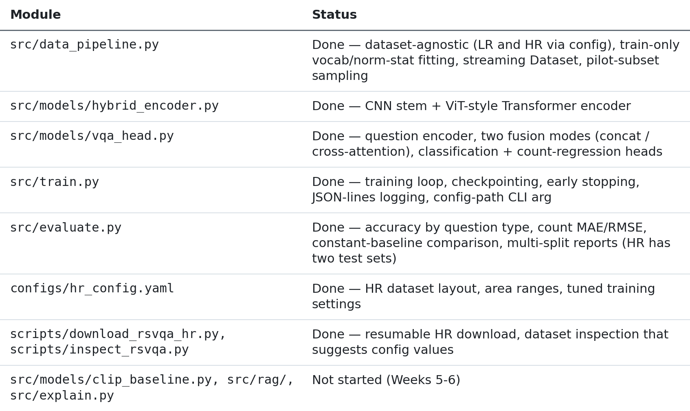

<details><summary>Table as text</summary>

| Module | Status |
|---|---|
| `src/data_pipeline.py` | Done — dataset-agnostic (LR and HR via config), train-only vocab/norm-stat fitting, streaming `Dataset`, pilot-subset sampling |
| `src/models/hybrid_encoder.py` | Done — CNN stem + ViT-style Transformer encoder |
| `src/models/vqa_head.py` | Done — question encoder, two fusion modes (concat / cross-attention), classification + count-regression heads |
| `src/train.py` | Done — training loop, checkpointing, early stopping, JSON-lines logging, config-path CLI arg |
| `src/evaluate.py` | Done — accuracy by question type, count MAE/RMSE, constant-baseline comparison, multi-split reports (HR has two test sets) |
| `configs/hr_config.yaml` | Done — HR dataset layout, area ranges, tuned training settings |
| `scripts/download_rsvqa_hr.py`, `scripts/inspect_rsvqa.py` | Done — resumable HR download, dataset inspection that suggests config values |
| `src/models/clip_baseline.py`, `src/rag/`, `src/explain.py` | Not started (Weeks 5-6) |

</details>

Run `pytest tests/ -v` to verify (80 tests, all passing — includes HR code paths tested against a small synthetic fake-HR dataset, so they don't require the real 14GB download).

The HR data was downloaded and inspected on 2026-10-22: 10,659 tiles (512×512 PNG), 4 splits with no
tile overlap, and question types presence / comp / area / count. Area answers turned out to be exact
values (`'1234m2'`), so they're grouped into 5 ranges (`area_buckets`); count stays regression. The
first HR pilot run (1,500 train tiles) is done; results are below.

The pilot took ~1 hour per epoch on a Colab T4 because data loading capped training at ~60
samples/s: every question re-decoded its tile's 512×512 PNG and normalized it on Colab's 2 CPU
cores. Two changes address that (see Key design decisions): tiles are decoded once into a cache
(`cache_images`), and images reach the GPU as uint8 to be normalized there. On Colab the loader
went from 67 to 726 images/s, but epochs only dropped to ~38 min: the T4 itself became the
bottleneck at ~77 training samples/s.

The second pilot run also showed validation swinging between epochs (88% → 79% → 88% → 69%
accuracy) while training loss stayed smooth, and early stopping firing on those swings. Before any
tuning, training got: a fixed `seed`; a cosine learning-rate schedule with warmup (it had been
constant); `best.pt` and early stopping chosen by a score that weighs accuracy and count error
(`selection_metric: score`) instead of the combined loss; mixed precision on CUDA; and an explicit
`weight_decay`.

The third pilot run with these changes (2026-10-28) ran all 10 epochs at ~22 min each (down from
~38, from mixed precision), validation improved almost every epoch with no swings, and test
accuracy reached 88.5%. It is the baseline for Week 3 tuning.

Before tuning, two changes for the longer runs ahead: validation is one pass per epoch (it was
two: one for the loss, one for the metrics), and a run cut off by a disconnect can be resumed from
its `last.pt` (`python -m src.train --resume <run_dir>`, or `RESUME` in the Colab notebook), with the
same model, optimizer, schedule, early-stopping and random state.

Week 3 tuning is done (see Week 3 tuning below): small model, learning rate 1.5e-4. The Week 4 full
run is done too (see HR full run below): 90.2% test accuracy, count MAE 0.91.

**Next:** Week 5 (CLIP baseline, XAI).

### Week 1 baseline results (RSVQA-LR, 5 epochs, GPU)

See [`reports/baseline_results_week1_baseline_20261014-130407.md`](reports/baseline_results_week1_baseline_20261014-130407.md).

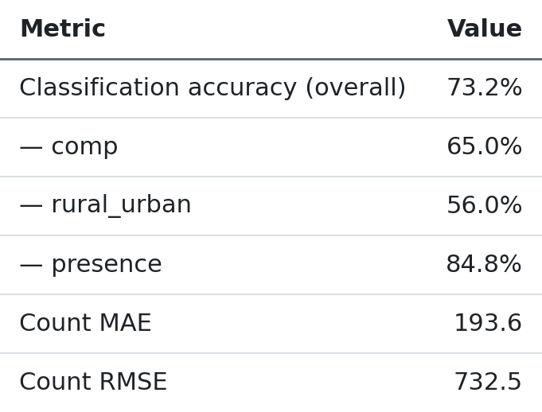

<details><summary>Table as text</summary>

| Metric | Value |
|---|---|
| Classification accuracy (overall) | 73.2% |
| — comp | 65.0% |
| — rural_urban | 56.0% |
| — presence | 84.8% |
| Count MAE | 193.6 |
| Count RMSE | 732.5 |

</details>

**Known issue found here, since fixed:** the count-regression head barely
learned — `val_class_acc` climbed steadily across epochs (55.5% → 75.7%)
while `val_count_mae` stayed flat/noisy, despite count MSE dominating the
combined loss by several orders of magnitude over the classification
cross-entropy. Root cause was a loss-scaling problem (raw RSVQA counts run
into the thousands), not a capacity problem. Fixed via a config-driven
`count_loss_transform` (`log1p` by default — MSE on `log(1 + count)` instead
of the raw value; `none` reproduces this baseline for comparison). Also added
a **cross-attention fusion** mode (`fusion_type: cross_attention`, now the
default) where question words attend directly over image patch tokens,
replacing the original CLS-vector-concat approach (kept as `fusion_type:
concat` for the ablation).

### Week 2 LR re-run (log1p count loss + cross-attention, GPU)

Validation results from `week2_crossattn` (stopped early after 10 of 15 epochs; best checkpoint
at epoch 7). Test-set numbers not run yet.

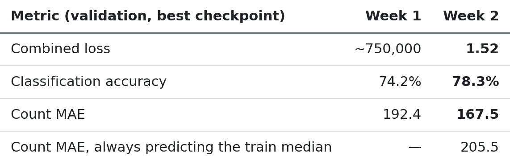

<details><summary>Table as text</summary>

| Metric (validation, best checkpoint) | Week 1 | Week 2 |
|---|---|---|
| Combined loss | ~750,000 | **1.52** |
| Classification accuracy | 74.2% | **78.3%** |
| Count MAE | 192.4 | **167.5** |
| Count MAE, always predicting the train median | — | 205.5 |

</details>

The loss is now on a sane scale and the count head beats the median baseline by ~18%, but count
predictions are still weak in absolute terms. LR counts are very skewed (median 6, max 16,640), so a
few huge-count tiles dominate MAE; HR counts are small (0–56), so this matters less there. Train loss
rose again after epoch 5 and val loss was noisy, consistent with a learning rate that's too high — the
HR config uses `3e-4` instead of `1e-3`.

### HR pilot results (1,500 train tiles, Colab T4)

See [`reports/baseline_results_hr_pilot_20261024-073555.md`](reports/baseline_results_hr_pilot_20261024-073555.md).
Early stopping ended training after 5 epochs; the best checkpoint is from epoch 2. Test sets are the
pilot's 300-tile subsets (~30,000 questions each), so treat these as early signals, not final results.

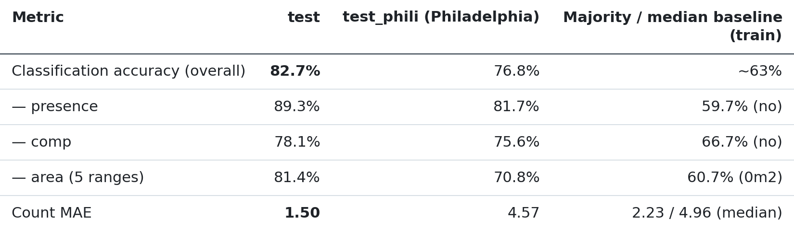

<details><summary>Table as text</summary>

| Metric | test | test_phili (Philadelphia) | Majority / median baseline (train) |
|---|---|---|---|
| Classification accuracy (overall) | **82.7%** | 76.8% | ~63% |
| — presence | 89.3% | 81.7% | 59.7% (`no`) |
| — comp | 78.1% | 75.6% | 66.7% (`no`) |
| — area (5 ranges) | 81.4% | 70.8% | 60.7% (`0m2`) |
| Count MAE | **1.50** | 4.57 | 2.23 / 4.96 (median) |

</details>

- Every question type clearly beats always giving the most common answer; comp is the hardest.
- `test_phili`, from a city the model never saw, is ~6 points lower, and its count MAE barely beats
  the median baseline (4.57 vs 4.96): count generalizes poorly to the denser new city.
- The best checkpoint was chosen by combined validation loss, which picked epoch 2 although validation
  accuracy kept rising to 86.4% at epoch 4 (count error rose instead). How to pick the best checkpoint
  is a Week 3 question.

**Second pilot run, identical settings** (after the data-loading speedup; see
[`reports/baseline_results_hr_pilot_20261027-131100.md`](reports/baseline_results_hr_pilot_20261027-131100.md)):
early stopping ended it after 7 epochs, best checkpoint from epoch 4.

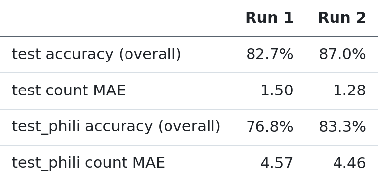

<details><summary>Table as text</summary>

| | Run 1 | Run 2 |
|---|---|---|
| test accuracy (overall) | 82.7% | 87.0% |
| test count MAE | 1.50 | 1.28 |
| test_phili accuracy (overall) | 76.8% | 83.3% |
| test_phili count MAE | 4.57 | 4.46 |

</details>

Nothing that affects learning changed between the runs, so the 4–6 point gap is **run-to-run
variation**: random initialization and shuffling, and above all which epoch early stopping kept
(epoch 2 vs epoch 4). Tuning changes smaller than this can't be told apart from luck, so Week 3 tuning
first needs a fixed seed and a better checkpoint-selection metric. Epochs took ~38 min on the T4,
which is now the bottleneck (data loading reaches ~726 images/s).

**Third pilot run** (seed, cosine LR schedule, score-based checkpoint selection, mixed precision; see
[`reports/baseline_results_hr_pilot_20261028-131854.md`](reports/baseline_results_hr_pilot_20261028-131854.md)):
ran all 10 epochs; the best checkpoint is the last one.

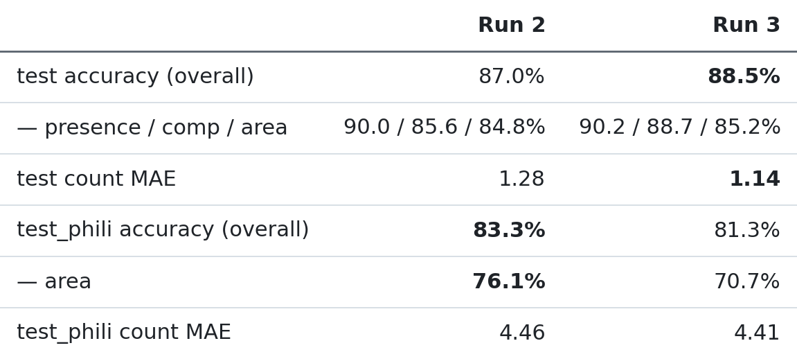

<details><summary>Table as text</summary>

| | Run 2 | Run 3 |
|---|---|---|
| test accuracy (overall) | 87.0% | **88.5%** |
| — presence / comp / area | 90.0 / 85.6 / 84.8% | 90.2 / 88.7 / 85.2% |
| test count MAE | 1.28 | **1.14** |
| test_phili accuracy (overall) | **83.3%** | 81.3% |
| — area | **76.1%** | 70.7% |
| test_phili count MAE | 4.46 | 4.41 |

</details>

- Validation accuracy rose every epoch (78.2% → 89.7%) and count MAE fell except for one small step
  back at epoch 5; the swings of run 2 are gone. Train loss stayed above validation loss (dropout is
  on during training), so there is no sign of overfitting yet.
- Validation was still improving when the learning rate reached 0 at epoch 10: the epoch budget, not
  early stopping, ended training.
- Epochs took ~22 min (run 2: ~38 min).
- `test` improved but `test_phili` got worse, mainly on area (−5.4 points). With one run per setting
  and 300-tile test subsets, this can't yet be told apart from run-to-run variation; the confirmation
  seeds in Week 3 will show it. Count on `test_phili` still barely beats the median baseline (4.41 vs
  4.96).
- This run changed several things at once, so the gain over run 2 can't be credited to any single one.

### Week 3 tuning (HR pilot, validation only)

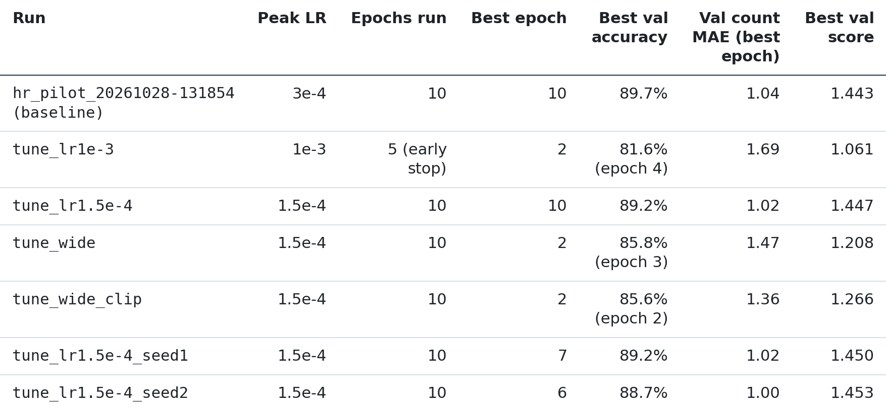

<details><summary>Table as text</summary>

| Run | Peak LR | Epochs run | Best epoch | Best val accuracy | Val count MAE (best epoch) | Best val score |
|---|---|---|---|---|---|---|
| `hr_pilot_20261028-131854` (baseline) | 3e-4 | 10 | 10 | 89.7% | 1.04 | 1.443 |
| `tune_lr1e-3` | 1e-3 | 5 (early stop) | 2 | 81.6% (epoch 4) | 1.69 | 1.061 |
| `tune_lr1.5e-4` | 1.5e-4 | 10 | 10 | 89.2% | 1.02 | 1.447 |
| `tune_wide` | 1.5e-4 | 10 | 2 | 85.8% (epoch 3) | 1.47 | 1.208 |
| `tune_wide_clip` | 1.5e-4 | 10 | 2 | 85.6% (epoch 2) | 1.36 | 1.266 |
| `tune_lr1.5e-4_seed1` | 1.5e-4 | 10 | 7 | 89.2% | 1.02 | 1.450 |
| `tune_lr1.5e-4_seed2` | 1.5e-4 | 10 | 6 | 88.7% | 1.00 | 1.453 |

</details>

- **1e-3 is worse than 3e-4.** At every epoch it trails the baseline: by epoch 5 train loss is 0.72
  vs 0.55, validation accuracy 78.6% vs 88.3%, and validation swings again (81.6% → 78.6%). Early
  stopping cut it while the LR was still 5.4e-4, so its end-of-schedule result is unknown; but it is
  so far behind on train loss that the cosine decay is unlikely to close a 10-point gap. Not rerun.
- Because of that, the planned 6e-4 run was replaced by 1.5e-4: with 1e-3 clearly worse, 6e-4 would
  probably land between the two, while 1.5e-4 tests the other side of 3e-4. Tuning runs from here
  disable early stopping, so each setting gets its full schedule.
- Epochs took ~21 min (baseline ~22.4): the single validation pass saves only ~1.5 min per pilot
  epoch, because validation is small next to training.
- **1.5e-4 ties with 3e-4.** The final validation score is 1.447 vs 1.443: 1.5e-4 has the lower
  count MAE (1.02 vs 1.04), 3e-4 the higher accuracy (89.7% vs 89.2%). Both differences are well
  inside the 4-point run-to-run spread seen between the first two pilot runs, so neither is a real
  win. 1.5e-4 is kept for the next step because it wins on the pre-declared score and because larger
  models tolerate high learning rates less well (1e-3 was already unstable).
- **The small model has saturated.** At 1.5e-4, validation accuracy sat at ~89% from epoch 6 on while
  train loss kept falling, ending equal to validation loss (0.418 vs 0.419). The whole model is only
  0.9M parameters, so the next run tests capacity.
- **Next run, `tune_wide`:** the transformer and fusion are widened and deepened (`d_model` 256, 4
  layers, 8 heads, `ffn_dim` 512, question embedding 256, fusion hidden 512; 3.3M parameters), the CNN
  stem is unchanged. On a Mac GPU it took ~1.7× as long per step as the base model; widening the CNN as
  well (3.9M parameters) took ~4×, too slow for the full run, so the CNN is left as is.
- **`tune_wide` failed: training became unstable after epoch 3.** It led the small model for the first
  3 epochs (85.8% vs 84.7% validation accuracy at epoch 3), then train loss rose (0.67 → 0.72) while
  the LR was decaying, and validation collapsed to 39–51% for the rest of the run (validation loss
  up to 4.7 while train loss stayed ~0.70). It says nothing yet about whether capacity helps.
  Two separate symptoms: the rising train loss is an optimization instability (the transformer is
  post-norm, with no gradient clipping); the far larger collapse in eval mode than in train mode
  points at the CNN's BatchNorm running statistics, the main layer that behaves differently in the two
  modes. Epochs took ~23 min, only ~5% longer than the small model on the T4.
- Added: gradient-norm logging per epoch (`grad_norm_mean`, `grad_norm_max`, `skipped_steps` in
  `log.jsonl`), optional clipping (`grad_clip_norm`), and `scripts/diagnose_run.py`, which evaluates a
  checkpoint as trained, in float32, and after recomputing BatchNorm statistics, to tell a BatchNorm
  failure from broken weights. Next: diagnose `tune_wide`'s `last.pt`, then rerun it with clipping
  at 1.0 (`tune_wide_clip`).
- **Diagnosis of `tune_wide`'s `last.pt`:** BatchNorm is ruled out (recomputing its statistics from
  200 training batches left validation at 46.6%, unchanged), and so is float16 overflow (float32 gives
  the same 46.6%). The script now also checks dropout (val with dropout on) and train vs val data
  (train batches in eval mode) to narrow down the remaining causes.
- **`tune_wide_clip` (same, with gradient clipping at 1.0) collapsed at epoch 3 as well**, recovering
  only to ~76% validation accuracy, while its train loss kept falling (0.54 at the end vs 1.05 val
  loss). The new gradient log shows why clipping could not prevent it: unclipped gradient norms grew
  from ~4 on average (max 174) in epoch 1 to ~88 on average (max ~12,000) by epochs 4-6, so clipping at
  1.0 capped nearly every step. Something inside the larger model diverges; clipping only limits how
  fast the weights move.
- **Decision: keep the small model.** Two attempts at the larger model failed at the same point, while
  the small model trained stably in every HR run. The larger model led for its first 2-3 epochs
  (85.6% vs 80.8% at epoch 2), so capacity may still help, but making it train stably (e.g. a
  pre-norm transformer, `norm_first=True`) is an architecture change that would need its own tuning
  round. Left as future work. Next: 2 more seeds of the small model at 1.5e-4, to measure the
  run-to-run spread, then the full run.
- **Run-to-run spread (seeds 0, 1, 2 at 1.5e-4) is small:** best validation score 1.447 / 1.450 /
  1.453, final-epoch accuracy 89.2 / 89.2 / 89.1%, final count MAE 1.02 / 1.04 / 1.02. The 4-point gap
  between the first two pilot runs came from the old setup (constant LR, early stopping on a noisy
  validation loss), not from seeds. Gradient norms in the small model stayed at ~4 on average (max
  42), against the larger model's ~88 (max ~12,000).
- **Learning rate, re-read with that spread:** 3e-4's final accuracy (89.7%) is ~0.5 points above all
  three 1.5e-4 seeds (89.1-89.2%), several times the seed spread, so that gap is probably real; its
  score (1.443) is below all three (1.447-1.453), because 1.5e-4 has the lower count MAE. The two rates
  trade classification against count. 1.5e-4 stays, because the selection score was fixed before
  tuning; switching to accuracy now, after seeing the results, would be choosing the metric to fit the
  outcome. (3e-4 was run with one seed only.)
- **Tuned config for the full run:** the small model, peak LR 1.5e-4, cosine schedule, 10 epochs,
  everything else as in `configs/hr_config.yaml`.

### HR full run (all 6,251 train tiles, Colab T4)

Run `hr_full_20261031-090319`, 2026-10-31: the tuned config (small model, peak LR 1.5e-4, cosine
schedule) on the full training split, 10 epochs, no early stopping. ~86 min per epoch, 14.4 h in total.
Full report: [`reports/baseline_results_hr_full_20261031-090319.md`](reports/baseline_results_hr_full_20261031-090319.md).

Validation (full val split) by epoch:

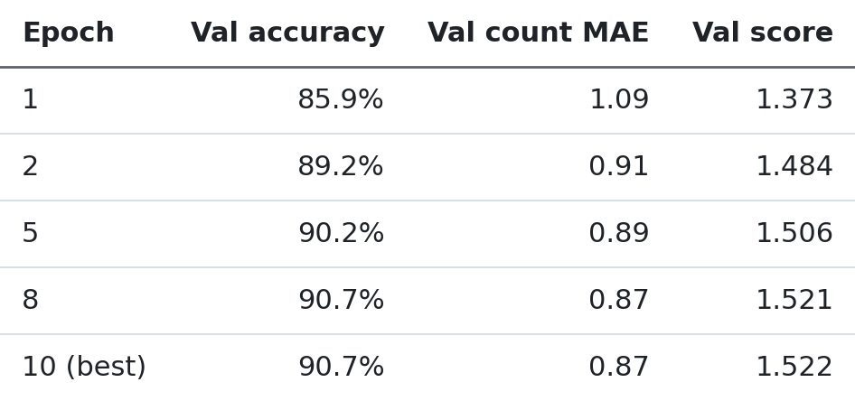

<details><summary>Table as text</summary>

| Epoch | Val accuracy | Val count MAE | Val score |
|---|---|---|---|
| 1 | 85.9% | 1.09 | 1.373 |
| 2 | 89.2% | 0.91 | 1.484 |
| 5 | 90.2% | 0.89 | 1.506 |
| 8 | 90.7% | 0.87 | 1.521 |
| 10 (best) | 90.7% | 0.87 | 1.522 |

</details>

Test results, complete test sets (2,226 + 1,056 tiles):

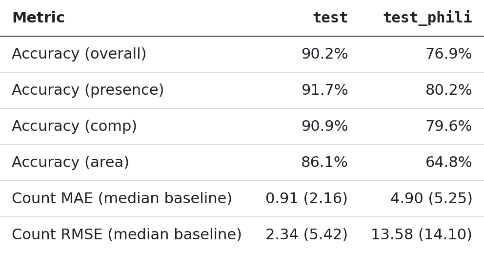

<details><summary>Table as text</summary>

| Metric | `test` | `test_phili` |
|---|---|---|
| Accuracy (overall) | 90.2% | 76.9% |
| Accuracy (presence) | 91.7% | 80.2% |
| Accuracy (comp) | 90.9% | 79.6% |
| Accuracy (area) | 86.1% | 64.8% |
| Count MAE (median baseline) | 0.91 (2.16) | 4.90 (5.25) |
| Count RMSE (median baseline) | 2.34 (5.42) | 13.58 (14.10) |

</details>

- **Training was stable.** Validation improved almost every epoch; the best epoch is the last one, with
  train and validation loss still close (0.325 / 0.348), so no sign of over-fitting. Gradient norms
  stayed at ~3.5-4 on average (max 37), as in the pilot. 7-10 skipped steps per epoch out of ~19,500
  are the mixed-precision loss scaler's normal overflow checks.

**Pilot vs full, same test tiles.** `tune_lr1.5e-4_20261029-101754` differs from the full run only in
training data (1,500 vs 6,251 tiles, so also about 4× the gradient steps at the same 10 epochs); the two
checkpoints' configs match otherwise, and both picked their last epoch as best. Both are evaluated on the
complete test sets. One seed each.

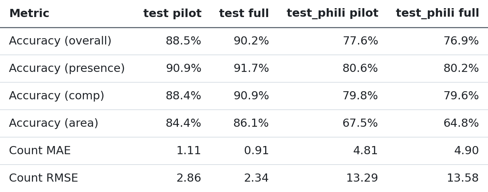

<details><summary>Table as text</summary>

| Metric | `test` pilot | `test` full | `test_phili` pilot | `test_phili` full |
|---|---|---|---|---|
| Accuracy (overall) | 88.5% | 90.2% | 77.6% | 76.9% |
| Accuracy (presence) | 90.9% | 91.7% | 80.6% | 80.2% |
| Accuracy (comp) | 88.4% | 90.9% | 79.8% | 79.6% |
| Accuracy (area) | 84.4% | 86.1% | 67.5% | 64.8% |
| Count MAE | 1.11 | 0.91 | 4.81 | 4.90 |
| Count RMSE | 2.86 | 2.34 | 13.29 | 13.58 |

</details>

- **More data helped on the same region, not on the new city.** On `test`, the full run gains 1.8 points
  of accuracy and cuts count MAE by 0.20. On `test_phili` it gains nothing: accuracy is 0.8 points lower,
  mostly from area questions (-2.7), and count is about the same. The spread of seeds was only measured
  on validation, so the small Philadelphia decline should be read as "no improvement", not as proven harm.
- **The Philadelphia gap is ~13 points** (90.2% vs 76.9%), and count there barely beats always predicting
  the median (MAE 4.90 vs 5.25). This is the main generalization result for the Week 7 error analysis.
- **Do not compare with the 81.3% from the HR pilot results above.** That is Run 3: a 300-tile subset at
  a different learning rate. Most of its 3.7-point lead over this pilot's 77.6% can't be separated between
  the two, as Run 3 was not evaluated on the complete set.

## Key design decisions

- **Count questions are a regression target**, not a classification bucket.
  `HybridVQAModel` has one shared backbone feeding two heads: a
  classification head (presence/comparison/rural_urban answers) and a
  scalar count-regression head. `vocab_size` in the config is the
  *classification* vocab only (4 classes for LR: `yes/no/rural/urban`) —
  count answers never enter that vocab.
- **Everything size-related is config-driven.** `image_size`, `vocab_size`,
  model dimensions, and training hyperparameters all live in
  `configs/model_config.yaml` — never hardcoded, so porting LR → HR is a
  config change, not a rewrite.
- **Train-only statistics.** The question vocabulary, answer vocabulary, and
  image normalization mean/std are all fit on the training split only, then
  reused (not recomputed) for val/test — prevents leakage.
- **Streaming-friendly from the start.** `RSVQADataset` loads images lazily
  in `__getitem__`, never eagerly into memory — same code path will handle
  HR's 10,659 images without a rewrite.
- **Each tile is decoded once, not once per question.** With `cache_images: true`
  (HR), `get_dataloaders` decodes each split's tiles into a memory-mapped
  `.npy` file under `<data_dir>/image_cache/` (~0.8 MB per HR tile on local disk,
  not RAM), reused across epochs and runs and rebuilt only when the tiles or
  `image_size` change. Every tile has ~100 questions, so this removes ~99% of
  decoding.
- **Images travel as uint8 and are normalized on the device.** Dataset items
  carry uint8 images; `prepare_batch` (used by training and evaluation) moves a
  batch to the GPU and normalizes it there with the train-split mean/std. This
  moves a quarter of the bytes between worker processes and takes the per-sample
  float work off the CPU.
- **Dataset layout is config-driven, not hardcoded to LR.** `split_file_prefix`,
  `images_subdir`, `image_ext`, `splits`, and `question_types` all live in
  config (`configs/model_config.yaml` for LR, `configs/hr_config.yaml` for
  HR) — the same `src/data_pipeline.py`/`src/evaluate.py` code serves both.
  `get_dataloaders` validates the configured `vocab_size` and each batch's
  `question_type`s against what the actual data contains, raising a clear
  error (not a silent mismatch) if they disagree.
- **A `data_dir`'s cached vocab/norm-stats are tagged with a manifest**
  (`raw_dir`, `split_file_prefix`, `images_subdir`, `image_ext`) recorded at
  build time — reusing a `data_dir` for a different raw dataset raises
  instead of silently serving stale artifacts built from the wrong data.
- **Cross-attention fusion** (default) has question words attend directly
  over image patch tokens, with retrievable per-word attention weights
  (`return_attention=True`) — the planned hook for Week 5's explainability
  work. The original concat+MLP fusion (CLS vector + mean-pooled question
  vector) is kept as `fusion_type: concat` for ablation.

## Setup

```bash
python3 -m venv .venv
source .venv/bin/activate
pip install -r requirements.txt
```

`requirements.txt` installs a CPU build of torch/torchvision by default; see
the comment at the top of that file for the CUDA install command on a GPU
machine.

### Data

**RSVQA-LR**: download it and place it at `data/raw/rsvqa_lr/` with this
layout (gitignored — not checked in):
```
data/raw/rsvqa_lr/
├── LR_split_{train,val,test}_{questions,answers,images}.json
├── all_questions.json, all_answers.json
└── images/Images_LR/*.tif
```

**RSVQA-HR**: `python scripts/download_rsvqa_hr.py data/raw/rsvqa_hr` (~14.4GB,
resumable, meant to be run on a box with real bandwidth — e.g. Colab). Then
`python scripts/inspect_rsvqa.py data/raw/rsvqa_hr USGS_split` to inspect the
actual file layout/answer vocabulary/question lengths and get a suggested
config block, already applied in `configs/hr_config.yaml`.

## Usage

**Run the test suite:**
```bash
pytest tests/ -v
```

**Train:**
```bash
python -m src.train                      # defaults to configs/model_config.yaml (LR)
python -m src.train configs/hr_config.yaml  # or train on HR instead
```
Trains `HybridVQAModel`, writes checkpoints + a JSON-lines log to
`experiments/<experiment_name>_<timestamp>/`, and prints the best
checkpoint's path.

**Evaluate / produce a results table:**
```bash
python -m src.evaluate experiments/<run_name>                      # LR
python -m src.evaluate experiments/<run_name> configs/hr_config.yaml  # HR
```
Loads that run's `checkpoints/best.pt` (model shape/hyperparameters come from
the checkpoint's own saved config, not the live YAML — so evaluating an older
checkpoint after editing the config can't silently mismatch), evaluates on
every split whose name starts with `test` (HR has two: `test` and the
Philadelphia `test_phili`), and writes a markdown report to
`reports/baseline_results_<run_name>.md`.

### Training on a GPU (e.g. Google Colab)

For HR, open [`notebooks/colab_hr_pilot.ipynb`](notebooks/colab_hr_pilot.ipynb) in Colab
(File → Open notebook → GitHub). It covers data setup from Drive, the area-range check, pilot
training with checkpoints written straight to Drive, and evaluation on both test sets. The steps
below describe the same process in general terms.

The local dev machine is CPU/MPS-only, so a full-dataset run is slow there.
To train on a GPU instead:

1. Push this repo to GitHub, `git clone` it in a Colab notebook with a GPU
   runtime.
2. `data/raw/` is gitignored, so get the RSVQA-LR data there separately —
   e.g. zip it, upload to Google Drive, mount Drive in Colab, and unzip into
   `data/raw/rsvqa_lr`.
3. Bump `num_workers` and `batch_size` in `configs/model_config.yaml` to use
   the GPU's extra headroom, then run the training/evaluate commands above.
4. Copy `experiments/` and `reports/baseline_results_*.md` back out (e.g. to
   Drive, or download directly) before the Colab session ends — nothing
   there persists across sessions.

## Configuration

All hyperparameters live in `configs/model_config.yaml` (LR) /
`configs/hr_config.yaml` (HR):

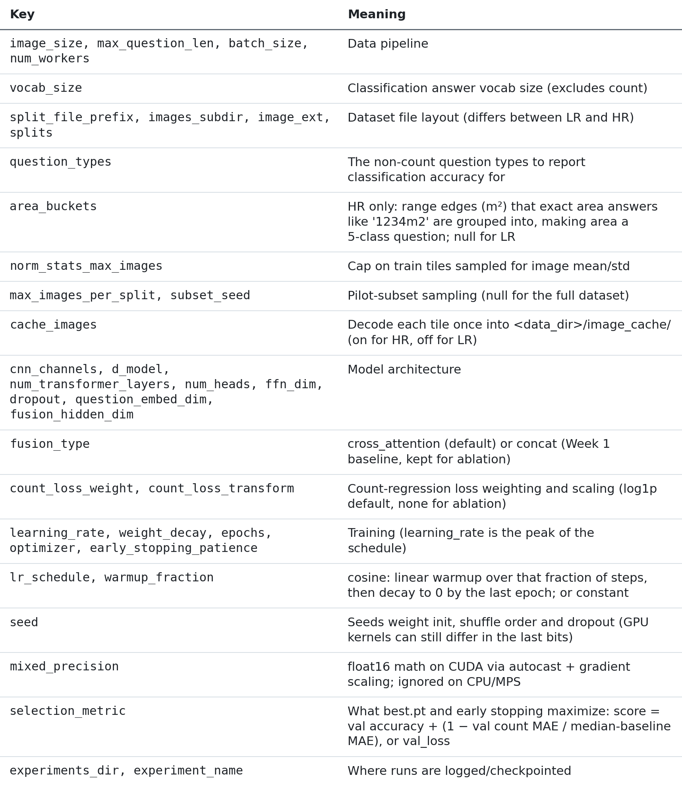

<details><summary>Table as text</summary>

| Key | Meaning |
|---|---|
| `image_size`, `max_question_len`, `batch_size`, `num_workers` | Data pipeline |
| `vocab_size` | Classification answer vocab size (excludes count) |
| `split_file_prefix`, `images_subdir`, `image_ext`, `splits` | Dataset file layout (differs between LR and HR) |
| `question_types` | The non-count question types to report classification accuracy for |
| `area_buckets` | HR only: range edges (m²) that exact area answers like `'1234m2'` are grouped into, making area a 5-class question; `null` for LR |
| `norm_stats_max_images` | Cap on train tiles sampled for image mean/std |
| `max_images_per_split`, `subset_seed` | Pilot-subset sampling (`null` for the full dataset) |
| `cache_images` | Decode each tile once into `<data_dir>/image_cache/` (on for HR, off for LR) |
| `cnn_channels`, `d_model`, `num_transformer_layers`, `num_heads`, `ffn_dim`, `dropout`, `question_embed_dim`, `fusion_hidden_dim` | Model architecture |
| `fusion_type` | `cross_attention` (default) or `concat` (Week 1 baseline, kept for ablation) |
| `count_loss_weight`, `count_loss_transform` | Count-regression loss weighting and scaling (`log1p` default, `none` for ablation) |
| `learning_rate`, `weight_decay`, `epochs`, `optimizer`, `early_stopping_patience` | Training (`learning_rate` is the peak of the schedule) |
| `lr_schedule`, `warmup_fraction` | `cosine`: linear warmup over that fraction of steps, then decay to 0 by the last epoch; or `constant` |
| `seed` | Seeds weight init, shuffle order and dropout (GPU kernels can still differ in the last bits) |
| `mixed_precision` | float16 math on CUDA via autocast + gradient scaling; ignored on CPU/MPS |
| `selection_metric` | What `best.pt` and early stopping maximize: `score` = val accuracy + (1 − val count MAE / median-baseline MAE), or `val_loss` |
| `experiments_dir`, `experiment_name` | Where runs are logged/checkpointed |

</details>

`question_vocab_size` is **not** a config key — it's a train-split artifact,
computed at runtime from `<data_dir>/vocab/question_vocab.json` and passed
into the model constructor explicitly (see `src/train.py:build_model`).

## Repository structure

```
src/
├── data_pipeline.py       # raw JSON/image loading -> training-ready batches (LR and HR)
├── models/
│   ├── hybrid_encoder.py  # CNN stem + Transformer encoder
│   ├── vqa_head.py        # question encoder, fusion (concat/cross-attention), dual heads, loss
│   └── clip_baseline.py   # zero-shot CLIP comparison (not started)
├── rag/                   # retrieval + LLM explanation layer (not started)
├── train.py
├── evaluate.py
└── explain.py             # attention rollout + Grad-CAM (not started)
scripts/
├── download_rsvqa_hr.py   # resumable HR download from Zenodo
├── inspect_rsvqa.py       # dataset inspection (LR or HR), suggests config values
├── diagnose_run.py        # checks a run whose validation collapsed
└── render_readme_tables.py  # README tables -> reports/figures/*.png
tests/                     # one test module per src/ module, plus test_data_layout.py
                           # (HR code paths, tested against a tiny synthetic fake-HR dataset)
configs/
├── model_config.yaml      # LR hyperparameters
└── hr_config.yaml         # HR hyperparameters
notebooks/                 # exploration + the Colab runner (colab_hr_pilot.ipynb); no pipeline logic
experiments/                # checkpoints + run logs (gitignored)
reports/                   # data inspection notes, baseline results tables
```
