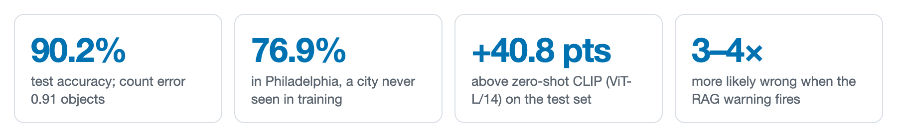
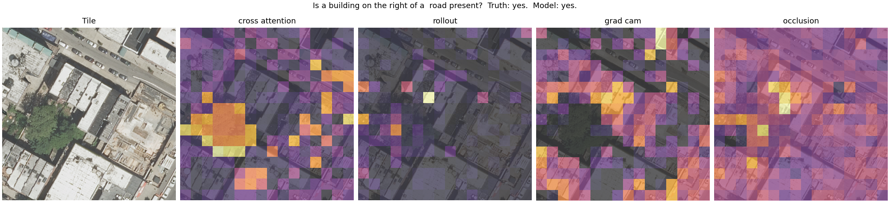
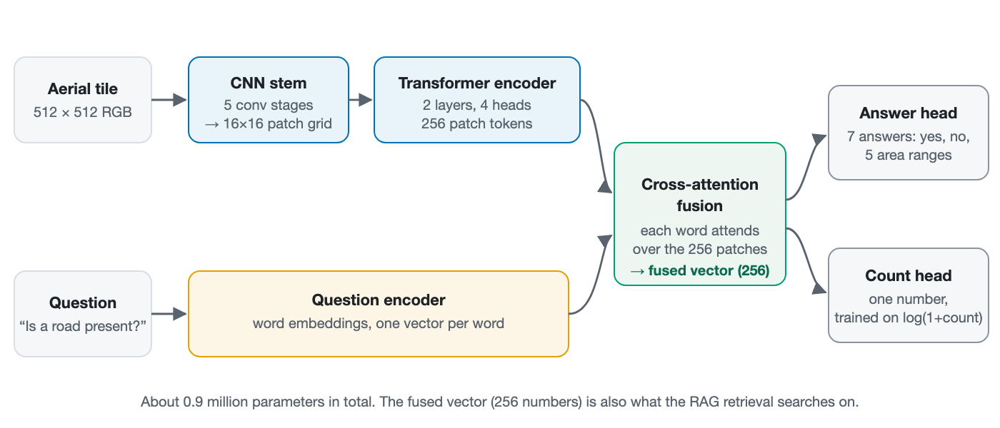
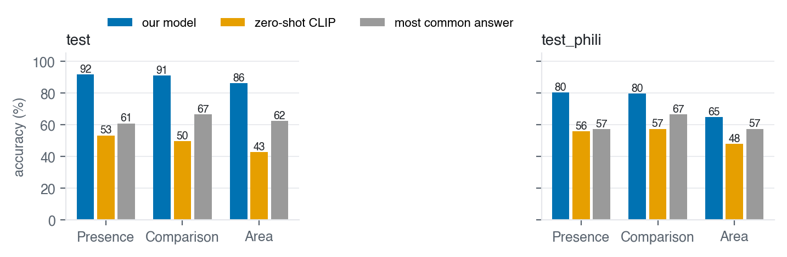
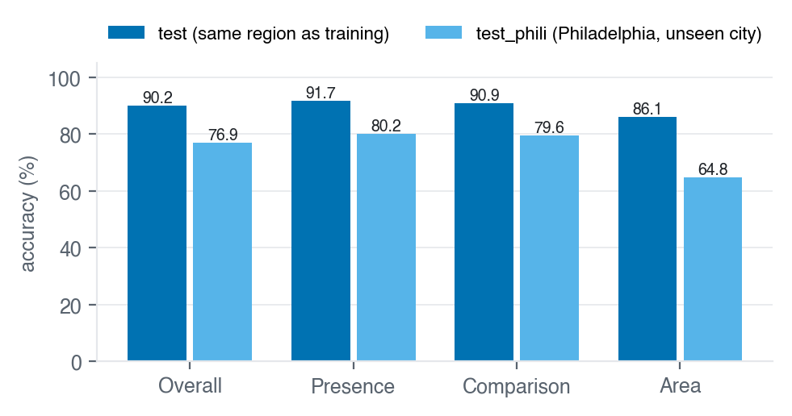
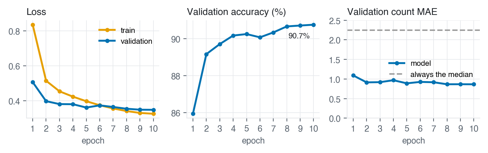
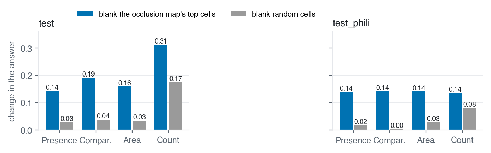
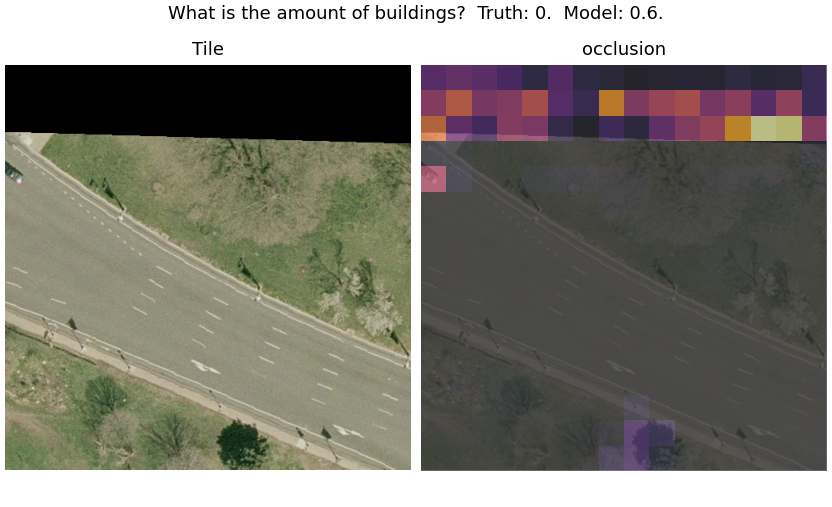
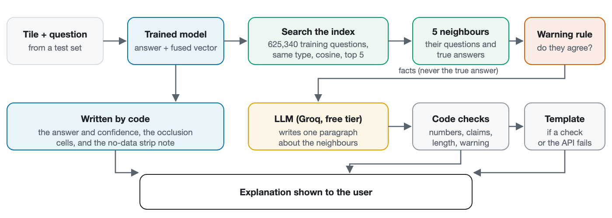
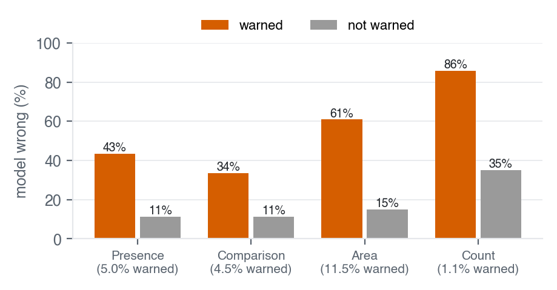

# Explainable Visual Question Answering on Aerial Images

**NGO THANH DAT** · Advanced Computer Vision + Big Data course project

Ask a question about an aerial photo ("Is there a road on the right of a park?", "How many buildings are there?")
and get an answer, a map of what the answer depended on, and a short explanation grounded in similar training
examples. A hybrid CNN-Transformer trained on RSVQA-HR (10,659 tiles, over 1 million questions), compared against
zero-shot CLIP, with explanation maps that were tested before being trusted, and retrieval-grounded LLM explanations.


📄 **[Progress report (PDF, 17 pages)](reports/RSVQA_progress_report_weeks1-6.pdf)** ·
📒 **[Full project log](docs/PROJECT_LOG.md)** (every run, table and decision)





*One question, four explanation maps. Only occlusion (right) passed the faithfulness tests; the attention maps that
look most "focused" did not.*

---

## How it works



- **Hybrid encoder.** A small CNN reads local texture (roofs, roads, trees); a Transformer relates the 256 patches
  across the image ("on the right of").
- **Cross-attention fusion.** Each word of the question attends over the image patches.
- **Two heads.** One picks among 7 answers (yes, no, 5 area ranges); one predicts counts as a number. About 0.9M
  parameters, trained on one Colab T4 GPU.

## Results



- **Our model beats zero-shot CLIP by 40.8 points** on the test set (90.2% vs 49.5%) and by 21.9 in Philadelphia.
  CLIP, untrained on this data, is below even "always give the most common answer".
- Counts: mean error **0.91** objects on the test set, against 2.16 for always guessing the median.



- **The main weakness: a new city.** In Philadelphia, never seen in training, accuracy drops 13 points, mostly on area
  questions (86.1% → 64.8%). Four times more training data helped on the familiar region, not on the new city.



*Full run on all 6,251 training tiles: 10 epochs, 14.4 hours, stable, no over-fitting.*

## Explainability: which maps can be trusted?

A heatmap can look convincing and still not reflect what the model used. Every map was tested by **blanking its top
cells and rerunning the model**: a faithful map should change the answer more than blanking random cells. Of five
methods (cross-attention, attention rollout, Grad-CAM, gradient-weighted attention, occlusion), **only occlusion
was confirmed: it beat random on every question type, in both test sets**.





*Philadelphia tile with a black no-data strip: occlusion's strongest cells sit at the strip, so explanations add a
caution there. Maps show what the answer depended on, not where an object is.*

## RAG explanations



For each answer, the 5 most similar training questions are retrieved from an index of **625,340**, by the model's own
fused vector. Code writes the facts (answer, confidence, occlusion cells); a free hosted LLM (`gpt-oss-120b` on Groq)
writes one paragraph about the neighbours, and **code checks it** (no invented numbers, no claims about the image, the
right warning) before it is shown, falling back to a template.

> The model answered "4". *The model's answer is uncertain because its count of 4 lies outside the range of true
> answers (6 to 12) seen in similar cases. Among the five most similar training questions, #1 asks "What is the amount
> of buildings?" with a true answer of 6, and #5 asks the same question with a true answer of 9.* Changing the cells
> at the top centre and top left of the tile changed the answer most.
>
> <sub>Italic: written by the LLM and checked. The rest: written by code. True answer: 71.</sub>



- **Retrieval flags wrong answers better than random neighbours on every question type** (AUROC 0.67 to 0.85).
- **A warned answer is 3–4× as likely to be wrong.** The warning is rare (1–12% of questions), so silence is not a
  guarantee.

## Limitations

- **New regions:** −13 points in an unseen city; counts there barely beat the median guess.
- **Only zero-shot CLIP was compared**, not a CLIP fine-tuned on RSVQA.
- **Maps are faithful, not object locations:** RSVQA has no object outlines to check against.
- **Explanations were not rated by people:** a blind rating was designed but not run, so no claim that they help users.

## Engineering

- **Rules before results:** checkpoint choice, map choice, the retrieval test and the warning rule were all fixed
  before their numbers were seen.
- **No leakage:** splits by image tile; vocabularies and normalisation fitted on the training split only.
- **Built for scale:** streamed data, tiles decoded once into a memory-mapped cache (loading 67 → 726 images/s),
  mixed precision, resumable training.
- **206 tests**, one module per source file; HR code paths tested on a small synthetic dataset.
- **Config-driven:** every hyperparameter in [`configs/hr_config.yaml`](configs/hr_config.yaml); the LLM key is read
  from an environment variable, never stored.

**Stack:** Python, PyTorch, Hugging Face Transformers (CLIP), NumPy, Matplotlib, pytest, Google Colab, Groq API.

## Quick start

```bash
python3 -m venv .venv && source .venv/bin/activate
pip install -r requirements.txt
pytest tests/                                             # 206 tests, no dataset needed

python scripts/download_rsvqa_hr.py data/raw/rsvqa_hr     # ~14.4 GB, resumable
python -m src.train configs/hr_config.yaml                # train (GPU recommended)
python -m src.evaluate experiments/<run> configs/hr_config.yaml
python -m src.models.clip_baseline configs/hr_config.yaml
python -m src.explain experiments/<run> configs/hr_config.yaml
python -m src.rag.retrieval_index experiments/<run> configs/hr_config.yaml
GROQ_API_KEY=... python -m src.rag.explain_agent experiments/<run> configs/hr_config.yaml generate
```

On Colab, [`notebooks/colab_hr_pilot.ipynb`](notebooks/colab_hr_pilot.ipynb) runs every step. Figures and the PDF are
rebuilt with `bash docs/report/build.sh`.

## Repository

```
src/
├── data_pipeline.py        # streaming loader, tile cache, training-only statistics
├── models/                 # hybrid encoder, fusion + two heads, CLIP baseline
├── train.py, evaluate.py   # training (resumable) and evaluation per question type and test set
├── explain.py              # five explanation maps and their faithfulness tests
└── rag/                    # retrieval index; checked LLM explanations
tests/                      # 206 tests
configs/                    # LR and HR settings
notebooks/                  # Colab runner
scripts/                    # dataset download and inspection, figures
docs/                       # project log, report source
reports/                    # results for every run, figures, the PDF report
```

## Roadmap

- **Week 7:** a local web demo (runs on a MacBook): pick a tile, ask a question, see the answer, the map and the
  explanation.
- **Week 8:** final report and presentation.
