# Project log: RSVQA Hybrid VQA, Weeks 1-6

The full week-by-week record: every run, table, decision and limitation. The short overview is the
[README](../README.md); the illustrated summary is the
[progress report (PDF)](../reports/RSVQA_progress_report_weeks1-6.pdf).

Explainable visual question answering on remote-sensing imagery: a hybrid
CNN-Transformer model benchmarked against zero-shot CLIP, with an
attention/saliency-based explainability (XAI) comparison and a lightweight
multimodal RAG explanation layer.

Proof-of-concept on **RSVQA-LR** (772 images, 77K QA pairs) first, then
ported to **RSVQA-HR** (10,659 images, 1M+ QA pairs) at full scale. See
[`RSVQA_Project_Plan.md`](../RSVQA_Project_Plan.md) for the full project plan
(problem/motivation/scope, dataset quality checklist, week-by-week roadmap),
and [`CLAUDE.md`](../CLAUDE.md) for the engineering conventions this repo
follows.

## Status

**Week 1 (RSVQA-LR pipeline) is complete, trained, and evaluated.**
**Weeks 2-4 (RSVQA-HR port, tuning, full run) are complete, trained, and evaluated.**
**Weeks 5-6 (CLIP baseline, explainability, RAG explanations) are complete.**

| Module | Status |
|---|---|
| `src/data_pipeline.py` | Done — dataset-agnostic (LR and HR via config), train-only vocab/norm-stat fitting, streaming `Dataset`, pilot-subset sampling |
| `src/models/hybrid_encoder.py` | Done — CNN stem + ViT-style Transformer encoder |
| `src/models/vqa_head.py` | Done — question encoder, two fusion modes (concat / cross-attention), classification + count-regression heads |
| `src/train.py` | Done — training loop, checkpointing, early stopping, JSON-lines logging, config-path CLI arg |
| `src/evaluate.py` | Done — accuracy by question type, count MAE/RMSE, constant-baseline comparison, multi-split reports (HR has two test sets) |
| `configs/hr_config.yaml` | Done — HR dataset layout, area ranges, tuned training settings |
| `scripts/download_rsvqa_hr.py`, `scripts/inspect_rsvqa.py` | Done — resumable HR download, dataset inspection that suggests config values |
| `src/models/clip_baseline.py` | Done: zero-shot CLIP on the complete test sets |
| `src/explain.py` | Done: five maps with deletion and sanity tests; occlusion confirmed on both test sets and without no-data strips; the first three maps failed |
| `src/rag/` | Done: retrieval index (beats random neighbours at flagging errors on every type) and checked LLM explanations with a template fallback; the human rating was not run |

Run `pytest tests/ -v` to verify (206 tests, all passing — includes HR code paths tested against a small synthetic fake-HR dataset, so they don't require the real 14GB download).

The HR data was downloaded and inspected on 2026-10-22: 10,659 tiles (512×512 PNG), 4 splits with no
tile overlap, and question types presence / comp / area / count. Area answers turned out to be exact
values (`'1234m2'`), so they're grouped into 5 ranges (`area_buckets`); count stays regression. The
first HR pilot run (1,500 train tiles) is done; results are below.

The pilot took ~1 hour per epoch on a Colab T4 because data loading capped training at ~60
samples/s: every question re-decoded its tile's 512×512 PNG and normalized it on Colab's 2 CPU
cores. Two changes address that (see Key design decisions): tiles are decoded once into a cache
(`cache_images`), and images reach the GPU as uint8 to be normalized there. On Colab the loader
went from 67 to 726 images/s, but epochs only dropped to ~38 min: the T4 itself became the
bottleneck at ~77 training samples/s.

The second pilot run also showed validation swinging between epochs (88% → 79% → 88% → 69%
accuracy) while training loss stayed smooth, and early stopping firing on those swings. Before any
tuning, training got: a fixed `seed`; a cosine learning-rate schedule with warmup (it had been
constant); `best.pt` and early stopping chosen by a score that weighs accuracy and count error
(`selection_metric: score`) instead of the combined loss; mixed precision on CUDA; and an explicit
`weight_decay`.

The third pilot run with these changes (2026-10-28) ran all 10 epochs at ~22 min each (down from
~38, from mixed precision), validation improved almost every epoch with no swings, and test
accuracy reached 88.5%. It is the baseline for Week 3 tuning.

Before tuning, two changes for the longer runs ahead: validation is one pass per epoch (it was
two: one for the loss, one for the metrics), and a run cut off by a disconnect can be resumed from
its `last.pt` (`python -m src.train --resume <run_dir>`, or `RESUME` in the Colab notebook), with the
same model, optimizer, schedule, early-stopping and random state.

Week 3 tuning is done (see Week 3 tuning below): small model, learning rate 1.5e-4. The Week 4 full
run is done too (see HR full run below): 90.2% test accuracy, count MAE 0.91.

**Next:** Week 7, the demo web app (runs locally on a Mac, with cached explanations for the demo questions).

### Week 1 baseline results (RSVQA-LR, 5 epochs, GPU)

See [`reports/baseline_results_week1_baseline_20261014-130407.md`](../reports/baseline_results_week1_baseline_20261014-130407.md).

| Metric | Value |
|---|---|
| Classification accuracy (overall) | 73.2% |
| — comp | 65.0% |
| — rural_urban | 56.0% |
| — presence | 84.8% |
| Count MAE | 193.6 |
| Count RMSE | 732.5 |

**Known issue found here, since fixed:** the count-regression head barely
learned — `val_class_acc` climbed steadily across epochs (55.5% → 75.7%)
while `val_count_mae` stayed flat/noisy, despite count MSE dominating the
combined loss by several orders of magnitude over the classification
cross-entropy. Root cause was a loss-scaling problem (raw RSVQA counts run
into the thousands), not a capacity problem. Fixed via a config-driven
`count_loss_transform` (`log1p` by default — MSE on `log(1 + count)` instead
of the raw value; `none` reproduces this baseline for comparison). Also added
a **cross-attention fusion** mode (`fusion_type: cross_attention`, now the
default) where question words attend directly over image patch tokens,
replacing the original CLS-vector-concat approach (kept as `fusion_type:
concat` for the ablation).

### Week 2 LR re-run (log1p count loss + cross-attention, GPU)

Validation results from `week2_crossattn` (stopped early after 10 of 15 epochs; best checkpoint
at epoch 7). Test-set numbers not run yet.

| Metric (validation, best checkpoint) | Week 1 | Week 2 |
|---|---|---|
| Combined loss | ~750,000 | **1.52** |
| Classification accuracy | 74.2% | **78.3%** |
| Count MAE | 192.4 | **167.5** |
| Count MAE, always predicting the train median | — | 205.5 |

The loss is now on a sane scale and the count head beats the median baseline by ~18%, but count
predictions are still weak in absolute terms. LR counts are very skewed (median 6, max 16,640), so a
few huge-count tiles dominate MAE; HR counts are small (0–56), so this matters less there. Train loss
rose again after epoch 5 and val loss was noisy, consistent with a learning rate that's too high — the
HR config uses `3e-4` instead of `1e-3`.

### HR pilot results (1,500 train tiles, Colab T4)

See [`reports/baseline_results_hr_pilot_20261024-073555.md`](../reports/baseline_results_hr_pilot_20261024-073555.md).
Early stopping ended training after 5 epochs; the best checkpoint is from epoch 2. Test sets are the
pilot's 300-tile subsets (~30,000 questions each), so treat these as early signals, not final results.

| Metric | test | test_phili (Philadelphia) | Majority / median baseline (train) |
|---|---|---|---|
| Classification accuracy (overall) | **82.7%** | 76.8% | ~63% |
| — presence | 89.3% | 81.7% | 59.7% (`no`) |
| — comp | 78.1% | 75.6% | 66.7% (`no`) |
| — area (5 ranges) | 81.4% | 70.8% | 60.7% (`0m2`) |
| Count MAE | **1.50** | 4.57 | 2.23 / 4.96 (median) |

- Every question type clearly beats always giving the most common answer; comp is the hardest.
- `test_phili`, from a city the model never saw, is ~6 points lower, and its count MAE barely beats
  the median baseline (4.57 vs 4.96): count generalizes poorly to the denser new city.
- The best checkpoint was chosen by combined validation loss, which picked epoch 2 although validation
  accuracy kept rising to 86.4% at epoch 4 (count error rose instead). How to pick the best checkpoint
  is a Week 3 question.

**Second pilot run, identical settings** (after the data-loading speedup; see
[`reports/baseline_results_hr_pilot_20261027-131100.md`](../reports/baseline_results_hr_pilot_20261027-131100.md)):
early stopping ended it after 7 epochs, best checkpoint from epoch 4.

| | Run 1 | Run 2 |
|---|---|---|
| test accuracy (overall) | 82.7% | 87.0% |
| test count MAE | 1.50 | 1.28 |
| test_phili accuracy (overall) | 76.8% | 83.3% |
| test_phili count MAE | 4.57 | 4.46 |

Nothing that affects learning changed between the runs, so the 4–6 point gap is **run-to-run
variation**: random initialization and shuffling, and above all which epoch early stopping kept
(epoch 2 vs epoch 4). Tuning changes smaller than this can't be told apart from luck, so Week 3 tuning
first needs a fixed seed and a better checkpoint-selection metric. Epochs took ~38 min on the T4,
which is now the bottleneck (data loading reaches ~726 images/s).

**Third pilot run** (seed, cosine LR schedule, score-based checkpoint selection, mixed precision; see
[`reports/baseline_results_hr_pilot_20261028-131854.md`](../reports/baseline_results_hr_pilot_20261028-131854.md)):
ran all 10 epochs; the best checkpoint is the last one.

| | Run 2 | Run 3 |
|---|---|---|
| test accuracy (overall) | 87.0% | **88.5%** |
| — presence / comp / area | 90.0 / 85.6 / 84.8% | 90.2 / 88.7 / 85.2% |
| test count MAE | 1.28 | **1.14** |
| test_phili accuracy (overall) | **83.3%** | 81.3% |
| — area | **76.1%** | 70.7% |
| test_phili count MAE | 4.46 | 4.41 |

- Validation accuracy rose every epoch (78.2% → 89.7%) and count MAE fell except for one small step
  back at epoch 5; the swings of run 2 are gone. Train loss stayed above validation loss (dropout is
  on during training), so there is no sign of overfitting yet.
- Validation was still improving when the learning rate reached 0 at epoch 10: the epoch budget, not
  early stopping, ended training.
- Epochs took ~22 min (run 2: ~38 min).
- `test` improved but `test_phili` got worse, mainly on area (−5.4 points). With one run per setting
  and 300-tile test subsets, this can't yet be told apart from run-to-run variation; the confirmation
  seeds in Week 3 will show it. Count on `test_phili` still barely beats the median baseline (4.41 vs
  4.96).
- This run changed several things at once, so the gain over run 2 can't be credited to any single one.

### Week 3 tuning (HR pilot, validation only)

| Run | Peak LR | Epochs run | Best epoch | Best val accuracy | Val count MAE (best epoch) | Best val score |
|---|---|---|---|---|---|---|
| `hr_pilot_20261028-131854` (baseline) | 3e-4 | 10 | 10 | 89.7% | 1.04 | 1.443 |
| `tune_lr1e-3` | 1e-3 | 5 (early stop) | 2 | 81.6% (epoch 4) | 1.69 | 1.061 |
| `tune_lr1.5e-4` | 1.5e-4 | 10 | 10 | 89.2% | 1.02 | 1.447 |
| `tune_wide` | 1.5e-4 | 10 | 2 | 85.8% (epoch 3) | 1.47 | 1.208 |
| `tune_wide_clip` | 1.5e-4 | 10 | 2 | 85.6% (epoch 2) | 1.36 | 1.266 |
| `tune_lr1.5e-4_seed1` | 1.5e-4 | 10 | 7 | 89.2% | 1.02 | 1.450 |
| `tune_lr1.5e-4_seed2` | 1.5e-4 | 10 | 6 | 88.7% | 1.00 | 1.453 |

- **1e-3 is worse than 3e-4.** At every epoch it trails the baseline: by epoch 5 train loss is 0.72
  vs 0.55, validation accuracy 78.6% vs 88.3%, and validation swings again (81.6% → 78.6%). Early
  stopping cut it while the LR was still 5.4e-4, so its end-of-schedule result is unknown; but it is
  so far behind on train loss that the cosine decay is unlikely to close a 10-point gap. Not rerun.
- Because of that, the planned 6e-4 run was replaced by 1.5e-4: with 1e-3 clearly worse, 6e-4 would
  probably land between the two, while 1.5e-4 tests the other side of 3e-4. Tuning runs from here
  disable early stopping, so each setting gets its full schedule.
- Epochs took ~21 min (baseline ~22.4): the single validation pass saves only ~1.5 min per pilot
  epoch, because validation is small next to training.
- **1.5e-4 ties with 3e-4.** The final validation score is 1.447 vs 1.443: 1.5e-4 has the lower
  count MAE (1.02 vs 1.04), 3e-4 the higher accuracy (89.7% vs 89.2%). Both differences are well
  inside the 4-point run-to-run spread seen between the first two pilot runs, so neither is a real
  win. 1.5e-4 is kept for the next step because it wins on the pre-declared score and because larger
  models tolerate high learning rates less well (1e-3 was already unstable).
- **The small model has saturated.** At 1.5e-4, validation accuracy sat at ~89% from epoch 6 on while
  train loss kept falling, ending equal to validation loss (0.418 vs 0.419). The whole model is only
  0.9M parameters, so the next run tests capacity.
- **Next run, `tune_wide`:** the transformer and fusion are widened and deepened (`d_model` 256, 4
  layers, 8 heads, `ffn_dim` 512, question embedding 256, fusion hidden 512; 3.3M parameters), the CNN
  stem is unchanged. On a Mac GPU it took ~1.7× as long per step as the base model; widening the CNN as
  well (3.9M parameters) took ~4×, too slow for the full run, so the CNN is left as is.
- **`tune_wide` failed: training became unstable after epoch 3.** It led the small model for the first
  3 epochs (85.8% vs 84.7% validation accuracy at epoch 3), then train loss rose (0.67 → 0.72) while
  the LR was decaying, and validation collapsed to 39–51% for the rest of the run (validation loss
  up to 4.7 while train loss stayed ~0.70). It says nothing yet about whether capacity helps.
  Two separate symptoms: the rising train loss is an optimization instability (the transformer is
  post-norm, with no gradient clipping); the far larger collapse in eval mode than in train mode
  points at the CNN's BatchNorm running statistics, the main layer that behaves differently in the two
  modes. Epochs took ~23 min, only ~5% longer than the small model on the T4.
- Added: gradient-norm logging per epoch (`grad_norm_mean`, `grad_norm_max`, `skipped_steps` in
  `log.jsonl`), optional clipping (`grad_clip_norm`), and `scripts/diagnose_run.py`, which evaluates a
  checkpoint as trained, in float32, and after recomputing BatchNorm statistics, to tell a BatchNorm
  failure from broken weights. Next: diagnose `tune_wide`'s `last.pt`, then rerun it with clipping
  at 1.0 (`tune_wide_clip`).
- **Diagnosis of `tune_wide`'s `last.pt`:** BatchNorm is ruled out (recomputing its statistics from
  200 training batches left validation at 46.6%, unchanged), and so is float16 overflow (float32 gives
  the same 46.6%). The script now also checks dropout (val with dropout on) and train vs val data
  (train batches in eval mode) to narrow down the remaining causes.
- **`tune_wide_clip` (same, with gradient clipping at 1.0) collapsed at epoch 3 as well**, recovering
  only to ~76% validation accuracy, while its train loss kept falling (0.54 at the end vs 1.05 val
  loss). The new gradient log shows why clipping could not prevent it: unclipped gradient norms grew
  from ~4 on average (max 174) in epoch 1 to ~88 on average (max ~12,000) by epochs 4-6, so clipping at
  1.0 capped nearly every step. Something inside the larger model diverges; clipping only limits how
  fast the weights move.
- **Decision: keep the small model.** Two attempts at the larger model failed at the same point, while
  the small model trained stably in every HR run. The larger model led for its first 2-3 epochs
  (85.6% vs 80.8% at epoch 2), so capacity may still help, but making it train stably (e.g. a
  pre-norm transformer, `norm_first=True`) is an architecture change that would need its own tuning
  round. Left as future work. Next: 2 more seeds of the small model at 1.5e-4, to measure the
  run-to-run spread, then the full run.
- **Run-to-run spread (seeds 0, 1, 2 at 1.5e-4) is small:** best validation score 1.447 / 1.450 /
  1.453, final-epoch accuracy 89.2 / 89.2 / 89.1%, final count MAE 1.02 / 1.04 / 1.02. The 4-point gap
  between the first two pilot runs came from the old setup (constant LR, early stopping on a noisy
  validation loss), not from seeds. Gradient norms in the small model stayed at ~4 on average (max
  42), against the larger model's ~88 (max ~12,000).
- **Learning rate, re-read with that spread:** 3e-4's final accuracy (89.7%) is ~0.5 points above all
  three 1.5e-4 seeds (89.1-89.2%), several times the seed spread, so that gap is probably real; its
  score (1.443) is below all three (1.447-1.453), because 1.5e-4 has the lower count MAE. The two rates
  trade classification against count. 1.5e-4 stays, because the selection score was fixed before
  tuning; switching to accuracy now, after seeing the results, would be choosing the metric to fit the
  outcome. (3e-4 was run with one seed only.)
- **Tuned config for the full run:** the small model, peak LR 1.5e-4, cosine schedule, 10 epochs,
  everything else as in `configs/hr_config.yaml`.

### HR full run (all 6,251 train tiles, Colab T4)

Run `hr_full_20261031-090319`, 2026-10-31: the tuned config (small model, peak LR 1.5e-4, cosine
schedule) on the full training split, 10 epochs, no early stopping. ~86 min per epoch, 14.4 h in total.
Full report: [`reports/baseline_results_hr_full_20261031-090319.md`](../reports/baseline_results_hr_full_20261031-090319.md).

Validation (full val split) by epoch:

| Epoch | Val accuracy | Val count MAE | Val score |
|---|---|---|---|
| 1 | 85.9% | 1.09 | 1.373 |
| 2 | 89.2% | 0.91 | 1.484 |
| 5 | 90.2% | 0.89 | 1.506 |
| 8 | 90.7% | 0.87 | 1.521 |
| 10 (best) | 90.7% | 0.87 | 1.522 |

Test results, complete test sets (2,226 + 1,056 tiles):

| Metric | `test` | `test_phili` |
|---|---|---|
| Accuracy (overall) | 90.2% | 76.9% |
| Accuracy (presence) | 91.7% | 80.2% |
| Accuracy (comp) | 90.9% | 79.6% |
| Accuracy (area) | 86.1% | 64.8% |
| Count MAE (median baseline) | 0.91 (2.16) | 4.90 (5.25) |
| Count RMSE (median baseline) | 2.34 (5.42) | 13.58 (14.10) |

- **Training was stable.** Validation improved almost every epoch; the best epoch is the last one, with
  train and validation loss still close (0.325 / 0.348), so no sign of over-fitting. Gradient norms
  stayed at ~3.5-4 on average (max 37), as in the pilot. 7-10 skipped steps per epoch out of ~19,500
  are the mixed-precision loss scaler's normal overflow checks.

**Pilot vs full, same test tiles.** `tune_lr1.5e-4_20261029-101754` differs from the full run only in
training data (1,500 vs 6,251 tiles, so also about 4× the gradient steps at the same 10 epochs); the two
checkpoints' configs match otherwise, and both picked their last epoch as best. Both are evaluated on the
complete test sets. One seed each.

| Metric | `test` pilot | `test` full | `test_phili` pilot | `test_phili` full |
|---|---|---|---|---|
| Accuracy (overall) | 88.5% | 90.2% | 77.6% | 76.9% |
| Accuracy (presence) | 90.9% | 91.7% | 80.6% | 80.2% |
| Accuracy (comp) | 88.4% | 90.9% | 79.8% | 79.6% |
| Accuracy (area) | 84.4% | 86.1% | 67.5% | 64.8% |
| Count MAE | 1.11 | 0.91 | 4.81 | 4.90 |
| Count RMSE | 2.86 | 2.34 | 13.29 | 13.58 |

- **More data helped on the same region, not on the new city.** On `test`, the full run gains 1.8 points
  of accuracy and cuts count MAE by 0.20. On `test_phili` it gains nothing: accuracy is 0.8 points lower,
  mostly from area questions (-2.7), and count is about the same. The spread of seeds was only measured
  on validation, so the small Philadelphia decline should be read as "no improvement", not as proven harm.
- **The Philadelphia gap is ~13 points** (90.2% vs 76.9%), and count there barely beats always predicting
  the median (MAE 4.90 vs 5.25). This is the main generalization result for the Week 7 error analysis.
- **Do not compare with the 81.3% from the HR pilot results above.** That is Run 3: a 300-tile subset at
  a different learning rate. Most of its 3.7-point lead over this pilot's 77.6% can't be separated between
  the two, as Run 3 was not evaluated on the complete set.

### CLIP baseline (zero-shot, complete test sets)

`openai/clip-vit-large-patch14` with no training on RSVQA: for each question it scores one sentence per
candidate answer against the tile and takes the best. Candidates come from the train split, the sentence
template was chosen on validation, and each test set was scored once. Report:
`reports/baseline_results_clip_vit-large-patch14.md`.

| Metric | `test` ours | `test` CLIP | `test` trivial | `test_phili` ours | `test_phili` CLIP | `test_phili` trivial |
|---|---|---|---|---|---|---|
| Accuracy (overall) | 90.2% | 49.5% | 63.7% | 76.9% | 55.0% | 61.5% |
| Accuracy (presence) | 91.7% | 53.2% | 60.8% | 80.2% | 55.8% | 57.3% |
| Accuracy (comp) | 90.9% | 49.6% | 66.6% | 79.6% | 57.4% | 66.6% |
| Accuracy (area) | 86.1% | 42.7% | 62.4% | 64.8% | 48.0% | 57.4% |
| Count MAE | 0.91 | 14.13 | 2.16 | 4.90 | 11.33 | 5.25 |
| Count RMSE | 2.34 | 20.37 | 5.42 | 13.58 | 17.31 | 14.10 |

"Trivial" always gives the most common train answer for the question type, or the train median for count.

- **Zero-shot CLIP is below the trivial guess on every question type, in both test sets.** Our model leads
  CLIP by 40.8 points on `test` and 21.9 on `test_phili`.
- **This is a low bar.** It mainly shows that a model trained on this task beats an untrained general one.
  It does not show that our architecture is better than a CLIP-based model fine-tuned on RSVQA.
- **The comparison is not like for like.** CLIP sees 224×224 (about 34 cm per pixel, against our 15 cm),
  which works against it. It only chooses among answers valid for the question type, which works for it.
- **Template choice.** The selection score was dominated by count error, but the chosen template
  `{question} {answer}` also had the best validation accuracy (48.8%, against 39.9% and 43.7%), so that
  weighting did not change the choice.
- **Unexplained:** CLIP scores 5.5 points higher on `test_phili` than on `test`, while our model drops 13.4.

### Explainability (XAI, `hr_full` model)

Three maps per answer: **cross-attention** (question words to patches), **rollout** (that attention traced
back through the encoder, since the fusion never reads CLS) and **Grad-CAM** (last CNN stage). Each is tested
by blanking its top patches and rerunning the model, against a random map. The rule for choosing a map was
fixed before any result: the largest deletion effect among maps that beat random on every question type and
pass both checks below. Sample: up to 250 right and 250 wrong answers per question type and test set (3,829
questions). Report: `reports/xai_results_hr_full_20261031-090319.md`.

**Final result: occlusion qualifies on both test sets (see Second attempt below).** The first attempt, described
here, ended with no map qualifying.

#### First attempt: attention and Grad-CAM

| Map | Beats random on | Correlation with random weights (limit 0.5) | Correlation between two questions (limit 0.9) | Outcome |
|---|---|---|---|---|
| Cross-attention | No type | 0.001 | 0.847 | Fails: not better than random |
| Rollout | All 4 types | 0.077 | **0.967** | Fails: barely changes with the question |
| Grad-CAM | Count only | 0.084 | 0.134 | Fails: not better than random; blank on 314 of 3,829 |

Rollout's deletion effect against the random map, by test set (probability drop, or log1p change for count):

| Type | `test` rollout | `test` random | `test_phili` rollout | `test_phili` random |
|---|---|---|---|---|
| Presence | 0.080 | 0.038 | 0.056 | 0.058 |
| Comparison | 0.084 | 0.057 | 0.022 | 0.024 |
| Area | 0.088 | 0.048 | 0.076 | 0.076 |
| Count | 0.313 | 0.175 | 0.145 | 0.133 |

- **Rollout finds regions that matter, but not per question.** It beats random clearly on `test`, yet its map
  for two different questions on one tile is nearly the same. It works as a general map of what matters in a
  tile, not as an explanation of a particular answer.
- **That advantage disappears in Philadelphia.** Rollout about ties random on all four types there. The pooled
  result hides this. No confidence intervals per test set were computed, and the cause is not established.
- **The random map is a harsh baseline.** Blanking one compact random patch changes answers less than scattered
  cells do. Against that secondary control, added after the pilot, rollout wins on all 4 types, cross-attention
  on 3 and Grad-CAM on 2. It does not change the outcome.
- **Limits.** RSVQA has no object masks, so nothing here measures whether a map points at the right object. The
  sample is balanced between right and wrong answers, so its averages are not population averages. The limits
  of 0.5 and 0.9 are judgment calls.

Examples, the presence figures for both test sets, right and wrong (tiles chosen by a fixed rule, not by appearance):

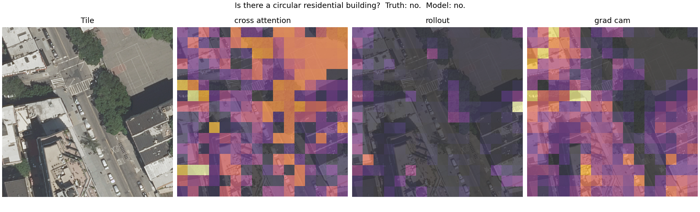
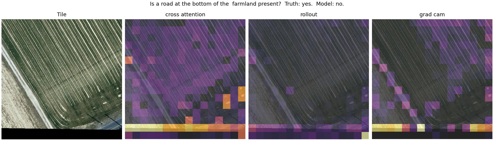
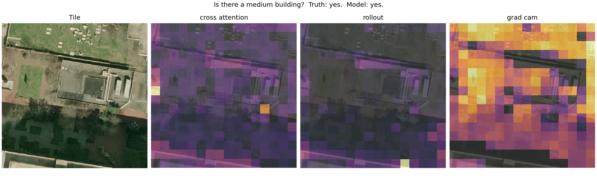
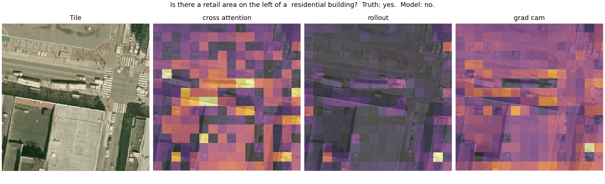

#### Second attempt: occlusion

After that failure, two further maps were tried: **gradient-weighted attention** (Chefer et al., 2021, every
attention step weighted by its gradient for this answer) and **occlusion** (grey out each grid cell in turn and
measure how much the answer changes, 256 model runs per question). The limits and the rule stayed the same.
Deletion changed from the mean colour to a blur, because occlusion builds its map with grey and would otherwise
be tested by the same operation. Both maps were run on val, and only the winner went to the test sets, once.
Reports: `reports/xai_results_hr_full_20261031-090319_new_val.md` and `_new_test.md`.

| Map | Stage (questions) | Standardized effect: presence / comparison / area / count | Correlation with random weights (limit 0.5) | Correlation between two questions (limit 0.9) | Outcome |
|---|---|---|---|---|---|
| Gradient-weighted attention | val (1,538) | 0.25 / 0.18 / 0.18 / 0.53 | -0.015 | 0.352 | Qualifies, not chosen: smaller effect |
| Occlusion | val (1,538) | 0.79 / 0.74 / 0.90 / 0.63 | 0.023 | 0.101 | Qualifies, chosen |
| Occlusion | both test sets (3,829) | 0.78 / 0.79 / 0.80 / 0.50 | 0.024 | 0.114 | **Confirmed** |

Occlusion's deletion effect against the random map, by test set (probability drop, or log1p change for count), with
the 95% lower bound on the difference:

| Type | `test` occlusion | `test` random | `test` lower bound | `test_phili` occlusion | `test_phili` random | `test_phili` lower bound |
|---|---|---|---|---|---|---|
| Presence | 0.143 | 0.028 | 0.101 | 0.139 | 0.017 | 0.108 |
| Comparison | 0.191 | 0.038 | 0.135 | 0.142 | 0.004 | 0.122 |
| Area | 0.159 | 0.034 | 0.113 | 0.141 | 0.028 | 0.100 |
| Count | 0.312 | 0.175 | 0.117 | 0.135 | 0.081 | 0.044 |

- **It holds in Philadelphia**, the city the model never saw and where rollout tied random. Count is the weakest
  type there: the answer changes on 21.9% of deletions, against 15.2% for random.
- **Faithful does not mean correct.** The map shows what this model relied on, including when it is wrong. It says
  nothing about whether that region contains the object asked about, because RSVQA has no object masks.
- **The test favours this method.** Occlusion measures the answer's sensitivity to removing a cell, and deletion
  checks much the same thing. Blurring reduces this advantage but does not remove it.
- **The first three maps were rerun with blur in a follow-up** (below), so the comparison is now like for like.
- **Other limits.** Most answers survive deletion: on presence, comparison and area the answer changes on 22-33% of
  deletions. The all-constant check found 3 maps of 3,829. The sample limits above still apply. Each answer takes
  1.48 s with its maps on a T4, against 0.009 s for the first three maps.

**The maps are hard to read as explanations.** In all 16 test figures (one per question type, test set, and right
or wrong answer), the strongest cells are mostly scattered and do not trace the object asked about. This is a visual
impression from a small sample, not a measurement. They should be read as "changing these cells changed the answer
most", not as "the model looked at this object".

#### Follow-up: no-data strips, and all maps under blur

Run after occlusion was confirmed, on the same 3,829 questions, so it could not change the choice. Report:
`reports/xai_results_hr_full_20261031-090319_followup.md`. A no-data cell is one with at least 25% of its pixels black
in every channel; a strip tile has at least one. All 9 strip tiles checked by eye in the pilot had real strips.

| Finding | `test` | `test_phili` |
|---|---|---|
| Sampled questions on strip tiles | 37 of 1,892 (2%) | 638 of 1,937 (33%) |
| Occlusion beats random without strip tiles | Every type | Every type |
| Occlusion's top 20% of cells in or beside the strip (strip tiles; chance in brackets) | 17.8% (12.7%) | 52.2% (21.7%) |
| Occlusion's top 20% on the outer ring (tiles without strips; chance 23.4%) | 26.6% | 30.0% |
| Rollout's top 20% on the outer ring (tiles without strips; chance 23.4%) | 45.9% | 52.2% |

- **Occlusion's confirmation stands.** Without the strip tiles it still beats random on every type, in each test set.
  Its effect on strip tiles is smaller, most of all for count (standardized 0.34 against 0.54 without strips).
- **On Philadelphia strip tiles, occlusion's strongest cells sit at the strip** at 2.4 times chance, far more than
  its slight preference for edges elsewhere. Replacing black with grey is a large edit, so this may be how the method
  behaves rather than how the model does; the two have not been separated.
- **Rollout's pull towards strips is mostly a pull towards edges:** it puts about half its top cells on the outer ring
  of tiles without strips too. This corrects an earlier reading of the pilot, which took rollout's strip result as a
  sign that the model itself attends to strips.
- **Strips do not explain the Philadelphia drop.** Over one question per tile and type, accuracy on Philadelphia strip
  tiles is not consistently lower than on its other tiles (presence 79.8% against 78.1%, comparison 76.8% against
  81.6%, area 69.9% against 64.1%, count 62.7% against 58.4%). This does not show the strips are harmless, since strip
  tiles may differ in other ways.
- **Under blur, Grad-CAM and cross-attention still fail.** Pooled, Grad-CAM does not beat random on presence,
  comparison or area, and in Philadelphia it is worse than random on those three. Cross-attention fails on presence
  and comparison. Rollout beats random on every type pooled (mean standardized 0.24, against occlusion's 0.72) but
  still fails its question check (0.967), which deletion does not affect.
- **Correct "yes" presence answers, where there is an object to point at,** show the same scattered maps in the 12
  figures drawn: no map clearly traces the object. Occlusion measures one cell at a time, so for an object spread over
  many cells, such as a road or many buildings, no single cell may matter much.

Examples, the presence figures for both test sets, right and wrong (tiles chosen by a fixed rule, not by appearance),
then one Philadelphia count figure, added by hand because it shows the strip:

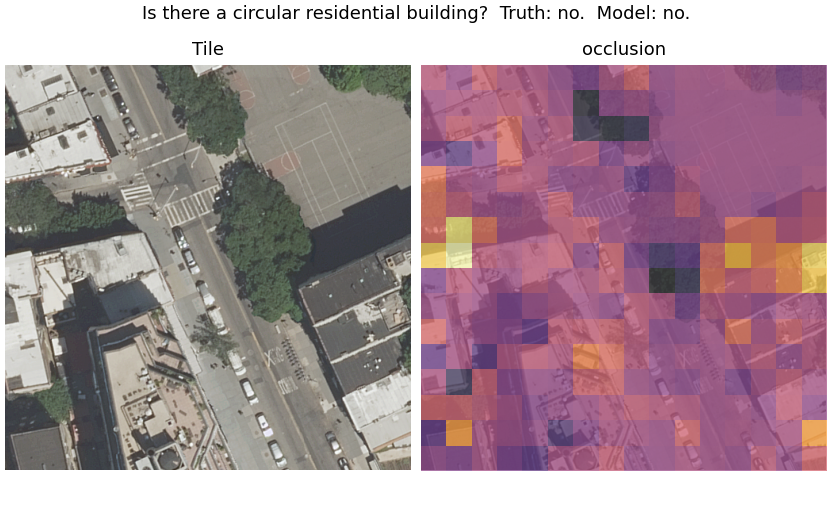
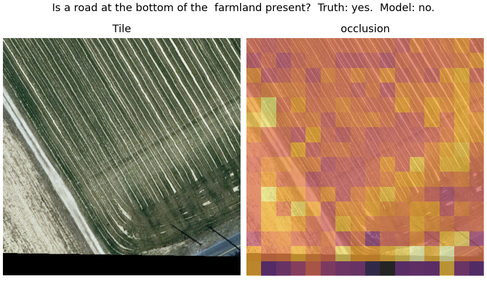
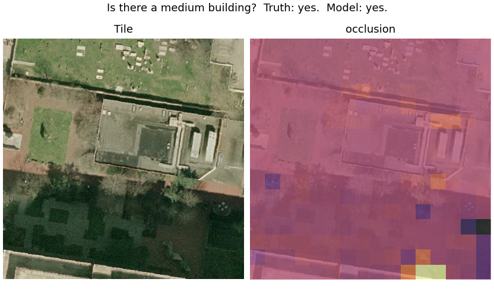
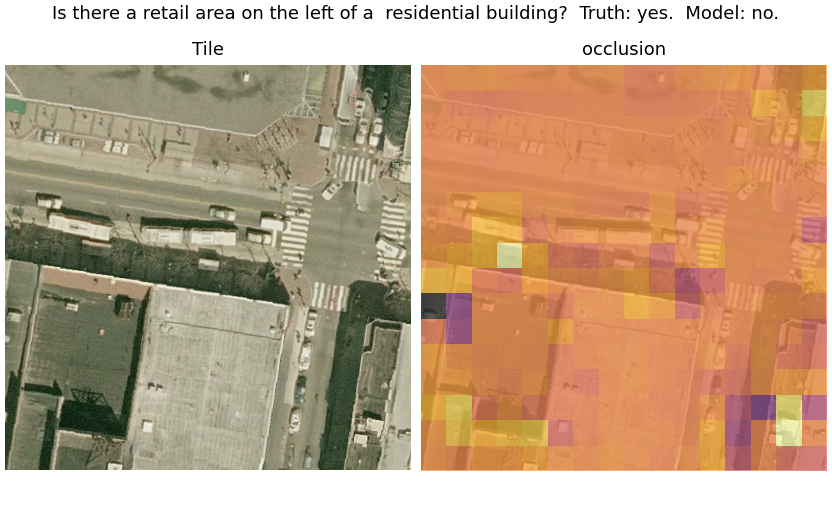
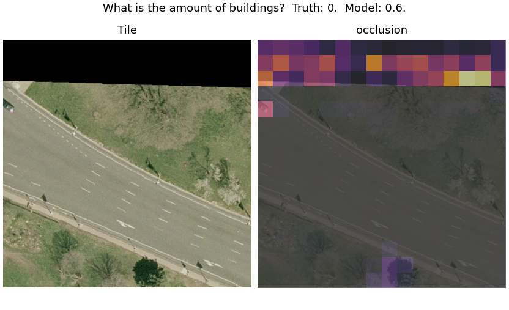

From the follow-up, all four maps under blur: the first correct "yes" presence answer on `test`, and the first
Philadelphia strip tile (both chosen by rule):

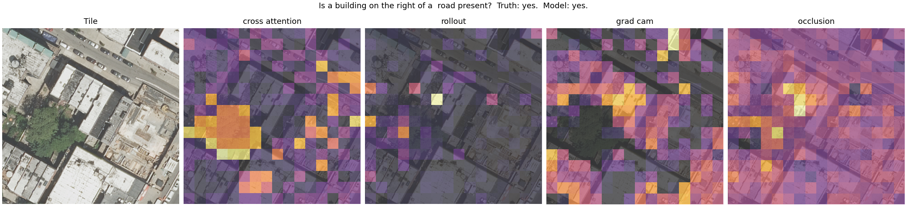
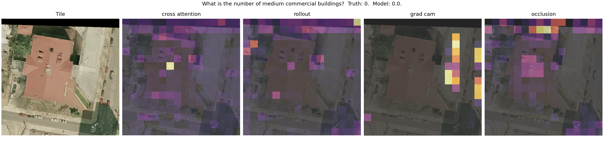

### RAG retrieval (Week 6, part 1)

The first half of the RAG explanation layer: an index of every training QA pair (625,340) stored as the trained
model's fused image-question vector, the vector both heads read. Nothing is trained. Each tile is encoded once, then
fused with each of its questions; building the index took 1.8 min on the T4 (320 MB). Report:
`reports/rag_retrieval_hr_full_20261031-090319.md`.

**Test, fixed before any result:** for one question per test tile and type (13,128), does disagreement between the
model's answer and its 5 nearest neighbours' true answers flag the model's mistakes better than 5 random same-type
training questions? Per type, the AUROC difference, both test sets pooled, needs a 95% bootstrap lower bound above 0.
Only types that pass may use neighbour disagreement as an uncertainty warning in the explanation.

| Type | AUROC retrieval | AUROC random | Difference [95% CI] | `test` alone | `test_phili` alone |
|---|---|---|---|---|---|
| Presence | 0.747 | 0.491 | +0.257 [+0.221, +0.294] | Passes | Passes |
| Comparison | 0.665 | 0.530 | +0.136 [+0.092, +0.174] | Passes | Fails (+0.053 [−0.007, +0.112]) |
| Area | 0.790 | 0.632 | +0.158 [+0.130, +0.184] | Passes | Passes |
| Count | 0.846 | 0.778 | +0.068 [+0.050, +0.087] | Fails (+0.017 [−0.004, +0.039]) | Passes |

- **Retrieval passes on every type,** so all four may carry the uncertainty warning.
- **Count's warning is mostly the size of the number.** Random neighbours already reach 0.778: a large count
  prediction disagrees with almost any neighbours, and large counts are more often wrong. Retrieval adds 0.068 pooled
  and nothing clear on `test` alone.
- **Comparison is the weakest type,** and in Philadelphia retrieval is not clearly better than random.
- **The neighbours mostly confirm the model:** their most common answer equals the model's for 95% of presence and
  comparison questions, 91% of area and 79% of count, and is about as accurate as the model itself (count MAE 2.19
  against the model's 2.16). Expected, since the heads read the same vector. So the warning fires on a minority of
  questions; it is not a second, better model.
- **Raw similarity is not shown to users.** The nearest neighbours score 0.99 to 1.00 cosine on every type, while
  random same-type pairs range from 0.31 (count) to 0.93 (comparison), so the scale is compressed and differs by type.
  58% to 80% of neighbours ask exactly the same question text. Explanations give a neighbour's rank, not its score.
- **The model gets 72% to 92% of the neighbours right, but they are training data,** so that is inflated by fitting
  and is not used in explanations as evidence of reliability. Explanations use the neighbours' true answers.

### RAG explanations (Week 6, part 2)

The second half: each answer gets a short text explanation built from the trained model's own evidence. Code writes
everything that is a plain fact: the answer and its confidence, which grid cells changed the answer most (the
occlusion map, the one that passed the XAI tests), and a note when the tile has a black no-data strip. A free hosted
LLM (`openai/gpt-oss-120b` on Groq's free tier) writes one paragraph about the 5 retrieved training neighbours:
what they asked, their true answers, and a warning when they disagree with the model. Reports:
`reports/rag_explanations_hr_full_20261031-090319.md` (full run) and `..._pilot.md` (the 24 pilot texts, labelled).

**The LLM paragraph is checked by code before it is shown.** It fails, and a fixed template paragraph is shown
instead, if it uses a number not in the facts, cites a neighbour other than #1 to #5, mentions the cells or the strip
(code writes those), says or implies what is in the image, gives reasons or causes for the answer ("based on",
"relied on", "the model sees"), calls anything correct or wrong, mentions similarity, runs over 90 words, or adds or
omits the uncertainty note against the rule. The LLM never sees the true answer or whether the model was right.
On the full run, the LLM paragraph passed for 60 of 64 main questions and 11 of 16 warned ones; 80 requests, 11
minutes, within the free tier. Three pilot rounds shaped the checks: the first prompt made the LLM invent training
cases it was not given, blame the warning on the model's confidence, and claim the neighbours caused the answer.

Example (pilot, a warned count question, true answer 71):

> The model answered "4". The model's answer is uncertain because its count of 4 lies outside the range of true
> answers (6 to 12) seen in similar cases. Among the five most similar training questions, #1 asks "What is the
> amount of buildings?" with a true answer of 6, and #5 asks the same question with a true answer of 9; none of the
> similar cases have a true answer of 4. Changing the cells at the top centre and top left of the tile changed the
> answer most. That tells you what the answer depended on, not where anything is.

**The uncertainty warning, rule fixed before any result:** a yes/no or area answer is warned when fewer than 3 of
its 5 neighbours have it as their true answer; a count is warned when, rounded, it falls outside the neighbours'
range of true counts. On one question per test tile and type (13,128), both test sets pooled:

| Type | Warned | Model wrong when warned | Model wrong otherwise |
|---|---|---|---|
| Presence | 5.0% | 43.3% | 11.3% |
| Comparison | 4.5% | 33.6% | 11.4% |
| Area | 11.5% | 60.9% | 15.1% |
| Count | 1.1% | 85.7% | 35.2% |

- **A warned answer is about 3 to 4 times as likely to be wrong** (count about 2.4 times), and this holds in both test
  sets. Comparison in Philadelphia separates least (29.0% against 19.5%), matching its retrieval result.
- **Most wrong answers are not warned.** The warning fires on 1% to 12% of questions, so it is a "be careful"
  signal, not a guarantee when it is silent. Count almost never warns, because the neighbours' range is usually wide.
- **Unanimous neighbours can back a wrong answer.** When all 5 neighbours share the model's wrong answer, the
  paragraph makes that answer sound well supported (pilot examples: test-6822, test_phili-17143, test_phili-12048).
- **Whether the explanations help people was not measured.** A blind rating was designed and generated (80 pairs,
  identical except for the neighbour paragraph, decision rule fixed in advance: Wilson 95% lower bound of the share
  preferring the version with neighbours above 0.5), but it was not carried out. So no claim is made that RAG makes
  the explanations better for readers; the claims rest on the retrieval test and the warning statistics above. The
  sheet and its scoring (`python -m src.rag.explain_agent <run_dir> configs/hr_config.yaml score --ratings <file>`)
  remain available.
- **Some derived statements are not checked.** The checks cover numbers, neighbour ranks and banned claims, not
  arithmetic the LLM does on the facts (for example "none of the similar cases has a true answer of 4").

## Key design decisions

- **Count questions are a regression target**, not a classification bucket.
  `HybridVQAModel` has one shared backbone feeding two heads: a
  classification head (presence/comparison/rural_urban answers) and a
  scalar count-regression head. `vocab_size` in the config is the
  *classification* vocab only (4 classes for LR: `yes/no/rural/urban`) —
  count answers never enter that vocab.
- **Everything size-related is config-driven.** `image_size`, `vocab_size`,
  model dimensions, and training hyperparameters all live in
  `configs/model_config.yaml` — never hardcoded, so porting LR → HR is a
  config change, not a rewrite.
- **Train-only statistics.** The question vocabulary, answer vocabulary, and
  image normalization mean/std are all fit on the training split only, then
  reused (not recomputed) for val/test — prevents leakage.
- **Streaming-friendly from the start.** `RSVQADataset` loads images lazily
  in `__getitem__`, never eagerly into memory — same code path will handle
  HR's 10,659 images without a rewrite.
- **Each tile is decoded once, not once per question.** With `cache_images: true`
  (HR), `get_dataloaders` decodes each split's tiles into a memory-mapped
  `.npy` file under `<data_dir>/image_cache/` (~0.8 MB per HR tile on local disk,
  not RAM), reused across epochs and runs and rebuilt only when the tiles or
  `image_size` change. Every tile has ~100 questions, so this removes ~99% of
  decoding.
- **Images travel as uint8 and are normalized on the device.** Dataset items
  carry uint8 images; `prepare_batch` (used by training and evaluation) moves a
  batch to the GPU and normalizes it there with the train-split mean/std. This
  moves a quarter of the bytes between worker processes and takes the per-sample
  float work off the CPU.
- **Dataset layout is config-driven, not hardcoded to LR.** `split_file_prefix`,
  `images_subdir`, `image_ext`, `splits`, and `question_types` all live in
  config (`configs/model_config.yaml` for LR, `configs/hr_config.yaml` for
  HR) — the same `src/data_pipeline.py`/`src/evaluate.py` code serves both.
  `get_dataloaders` validates the configured `vocab_size` and each batch's
  `question_type`s against what the actual data contains, raising a clear
  error (not a silent mismatch) if they disagree.
- **A `data_dir`'s cached vocab/norm-stats are tagged with a manifest**
  (`raw_dir`, `split_file_prefix`, `images_subdir`, `image_ext`) recorded at
  build time — reusing a `data_dir` for a different raw dataset raises
  instead of silently serving stale artifacts built from the wrong data.
- **Explanations: code states the facts, the LLM only summarises the neighbours.** The answer, the cells and the
  strip note are written by code in every explanation; the LLM writes one paragraph about the retrieved neighbours,
  and code checks it before it is shown, falling back to a template. The API key is read from an environment
  variable (`GROQ_API_KEY`), never stored in the repo.
- **Cross-attention fusion** (default) has question words attend directly
  over image patch tokens, with retrievable per-word attention weights
  (`return_attention=True`) — the planned hook for Week 5's explainability
  work. The original concat+MLP fusion (CLS vector + mean-pooled question
  vector) is kept as `fusion_type: concat` for ablation.

## Setup

```bash
python3 -m venv .venv
source .venv/bin/activate
pip install -r requirements.txt
```

`requirements.txt` installs a CPU build of torch/torchvision by default; see
the comment at the top of that file for the CUDA install command on a GPU
machine.

### Data

**RSVQA-LR**: download it and place it at `data/raw/rsvqa_lr/` with this
layout (gitignored — not checked in):
```
data/raw/rsvqa_lr/
├── LR_split_{train,val,test}_{questions,answers,images}.json
├── all_questions.json, all_answers.json
└── images/Images_LR/*.tif
```

**RSVQA-HR**: `python scripts/download_rsvqa_hr.py data/raw/rsvqa_hr` (~14.4GB,
resumable, meant to be run on a box with real bandwidth — e.g. Colab). Then
`python scripts/inspect_rsvqa.py data/raw/rsvqa_hr USGS_split` to inspect the
actual file layout/answer vocabulary/question lengths and get a suggested
config block, already applied in `configs/hr_config.yaml`.

## Usage

**Run the test suite:**
```bash
pytest tests/ -v
```

**Train:**
```bash
python -m src.train                      # defaults to configs/model_config.yaml (LR)
python -m src.train configs/hr_config.yaml  # or train on HR instead
```
Trains `HybridVQAModel`, writes checkpoints + a JSON-lines log to
`experiments/<experiment_name>_<timestamp>/`, and prints the best
checkpoint's path.

**Evaluate / produce a results table:**
```bash
python -m src.evaluate experiments/<run_name>                      # LR
python -m src.evaluate experiments/<run_name> configs/hr_config.yaml  # HR
```
Loads that run's `checkpoints/best.pt` (model shape/hyperparameters come from
the checkpoint's own saved config, not the live YAML — so evaluating an older
checkpoint after editing the config can't silently mismatch), evaluates on
every split whose name starts with `test` (HR has two: `test` and the
Philadelphia `test_phili`), and writes a markdown report to
`reports/baseline_results_<run_name>.md`.

### Training on a GPU (e.g. Google Colab)

For HR, open [`notebooks/colab_hr_pilot.ipynb`](../notebooks/colab_hr_pilot.ipynb) in Colab
(File → Open notebook → GitHub). It covers data setup from Drive, the area-range check, pilot
training with checkpoints written straight to Drive, and evaluation on both test sets. The steps
below describe the same process in general terms.

The local dev machine is CPU/MPS-only, so a full-dataset run is slow there.
To train on a GPU instead:

1. Push this repo to GitHub, `git clone` it in a Colab notebook with a GPU
   runtime.
2. `data/raw/` is gitignored, so get the RSVQA-LR data there separately —
   e.g. zip it, upload to Google Drive, mount Drive in Colab, and unzip into
   `data/raw/rsvqa_lr`.
3. Bump `num_workers` and `batch_size` in `configs/model_config.yaml` to use
   the GPU's extra headroom, then run the training/evaluate commands above.
4. Copy `experiments/` and `reports/baseline_results_*.md` back out (e.g. to
   Drive, or download directly) before the Colab session ends — nothing
   there persists across sessions.

## Configuration

All hyperparameters live in `configs/model_config.yaml` (LR) /
`configs/hr_config.yaml` (HR):

| Key | Meaning |
|---|---|
| `image_size`, `max_question_len`, `batch_size`, `num_workers` | Data pipeline |
| `vocab_size` | Classification answer vocab size (excludes count) |
| `split_file_prefix`, `images_subdir`, `image_ext`, `splits` | Dataset file layout (differs between LR and HR) |
| `question_types` | The non-count question types to report classification accuracy for |
| `area_buckets` | HR only: range edges (m²) that exact area answers like `'1234m2'` are grouped into, making area a 5-class question; `null` for LR |
| `norm_stats_max_images` | Cap on train tiles sampled for image mean/std |
| `max_images_per_split`, `subset_seed` | Pilot-subset sampling (`null` for the full dataset) |
| `cache_images` | Decode each tile once into `<data_dir>/image_cache/` (on for HR, off for LR) |
| `cnn_channels`, `d_model`, `num_transformer_layers`, `num_heads`, `ffn_dim`, `dropout`, `question_embed_dim`, `fusion_hidden_dim` | Model architecture |
| `fusion_type` | `cross_attention` (default) or `concat` (Week 1 baseline, kept for ablation) |
| `count_loss_weight`, `count_loss_transform` | Count-regression loss weighting and scaling (`log1p` default, `none` for ablation) |
| `learning_rate`, `weight_decay`, `epochs`, `optimizer`, `early_stopping_patience` | Training (`learning_rate` is the peak of the schedule) |
| `lr_schedule`, `warmup_fraction` | `cosine`: linear warmup over that fraction of steps, then decay to 0 by the last epoch; or `constant` |
| `seed` | Seeds weight init, shuffle order and dropout (GPU kernels can still differ in the last bits) |
| `mixed_precision` | float16 math on CUDA via autocast + gradient scaling; ignored on CPU/MPS |
| `selection_metric` | What `best.pt` and early stopping maximize: `score` = val accuracy + (1 − val count MAE / median-baseline MAE), or `val_loss` |
| `experiments_dir`, `experiment_name` | Where runs are logged/checkpointed |
| `rag_k`, `rag_*_batch_size`, `rag_search_chunk_rows`, `rag_bootstrap_samples` | RAG retrieval: neighbours per question, encoding and search batch sizes, bootstrap samples for the retrieval test |
| `rag_llm_*` | RAG explanations: OpenAI-compatible endpoint, model, the environment variable holding the API key, request pacing and retries |
| `rag_max_words`, `rag_top_cells`, `rag_warning_min_agree`, `rag_banned_phrases` | Explanation rules: paragraph length, cells named, the warning rule, phrases that send a paragraph back to the template |

`question_vocab_size` is **not** a config key — it's a train-split artifact,
computed at runtime from `<data_dir>/vocab/question_vocab.json` and passed
into the model constructor explicitly (see `src/train.py:build_model`).

## Repository structure

```
src/
├── data_pipeline.py       # raw JSON/image loading -> training-ready batches (LR and HR)
├── models/
│   ├── hybrid_encoder.py  # CNN stem + Transformer encoder
│   ├── vqa_head.py        # question encoder, fusion (concat/cross-attention), dual heads, loss
│   └── clip_baseline.py   # zero-shot CLIP comparison
├── rag/
│   ├── retrieval_index.py # index of training QA pairs by fused vector, tested against random neighbours
│   └── explain_agent.py   # explanations: code-written facts + checked LLM neighbour paragraph, warning stats
├── train.py
├── evaluate.py
└── explain.py             # attention, Grad-CAM and occlusion maps, with faithfulness tests
scripts/
├── download_rsvqa_hr.py   # resumable HR download from Zenodo
├── inspect_rsvqa.py       # dataset inspection (LR or HR), suggests config values
└── diagnose_run.py        # checks a run whose validation collapsed
tests/                     # one test module per src/ module, plus test_data_layout.py
                           # (HR code paths, tested against a tiny synthetic fake-HR dataset)
configs/
├── model_config.yaml      # LR hyperparameters
└── hr_config.yaml         # HR hyperparameters
notebooks/                 # exploration + the Colab runner (colab_hr_pilot.ipynb); no pipeline logic
experiments/                # checkpoints + run logs (gitignored)
reports/                   # data inspection notes, baseline results tables
```
